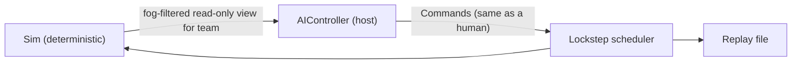

# AI Design (Skirmish, Campaign & World War II)

---

## 1. What the original did **[DATA]**

* A **Strategic AI ("SAI")** per nation (`SAI/*_sai*.tgi`) built from **personality templates**: `template_sai_aa_balanced`, `_infantry`, `_infantry_planes`, `_armor`, `_artillery`, `_planes`, `_mechanized`, `_research`, `_campaign` (`data/templates_AA.lst`).
* Each SAI moves through **Egos**: phase-specific behaviour sets such as `LowIncomeEgo → MainGameEgo → EndGameEgo`, starting from `initial_ego`. Each SAI declares `difficulty_level`, `public` (selectable) and the general(s) (`[Faction] ids = montgomery`...) it can play.
* A **Combat AI ("CAI")** drives engagement-level behaviour (`CAITargetInRangeZOCMultiplier` in SVars).
* The readme notes that "each AI player consumes bandwidth", so the original AI issued commands through the network like a player. We do the same.

We keep this structure, a **personality plus phase-based strategic AI layered over a combat AI**, and we **load personality parameters from the original SAI TGIs where they map cleanly**, so AI flavour matches per nation and general.

---

## 2. Core architectural decision

**The AI is a player controller that emits Commands. It runs on the host only and is not part of the deterministic sim.**



Consequences:
* The AI **can use floats, threads, time-slicing and GDScript.** It doesn't need to be deterministic because its *output* (commands) is recorded and broadcast.
* Replays reproduce AI games exactly, because they replay the commands, not the AI.
* A disconnected human's kingdom can be **handed to an AIController** seamlessly.
* Cost: AI commands get the same input delay as humans (≈300 ms), which is fine for RTS.
* The AI reads the **fog-filtered** world for its team. **No map hacking** at any difficulty. Difficulty comes from decision quality and speed, plus optional resource handicaps (`handicaps.tgi`).

What stays **inside the sim** (deterministic, applies to everyone): auto-engage in aggressive formations, target selection within an engagement, routing, auto-resupply/heal, building defenders, airfield fighters auto-defending. Those are **rules**, not AI.

---

## 3. Layers

```
┌──────────────────────────── Strategic (every 2 s) ────────────────────────────┐
│ Ego/phase state machine · Goals · Budget split (eco / army / tech / special ops) │
├──────────────────────────── Operational (every 1 s) ──────────────────────────┤
│ Influence maps · Objective scoring · Task forces (groups/divisions) · Supply plan│
├──────────────────────────── Tactical (every 0.5 s) ───────────────────────────┤
│ Per task force: formation, approach path, engage/disengage, retreat, focus fire  │
├──────────────────────────── Managers (event-driven) ──────────────────────────┤
│ Economy · Production · Base layout · Research · Special ops · Engineers/repair   │
└──────────────────────────────────────────────────────────────────────────────────┘
```
Intervals are staggered per AI player so several AIs don't spike the same frame.

### 3.1 Strategic layer: Egos (phases)

| Ego | Enter when | Priorities |
|---|---|---|
| **Opening / LowIncome** | game start, or income < threshold | Unpack Corps-adjacent Division HQ per personality, Ammo/Oil depots to keep upkeep positive, 2–4 cheap regiments, scout, grab nearest cities |
| **MainGame** | income and unit limit reasonable | Expand supply line (Supply Depots, repack HQs forward), contest cities, tech to brigades, build the main army mix, use special ops |
| **EndGame** | enemy weak (estimated) or unit limit maxed | Concentrate a division and push HQs. Prefer kill targets (Corps HQ). Spend all army XP. |
| **Defend (overlay)** | threat on own HQ/supply > defense | Pull the nearest task forces back, place bunkers with engineers, switch production to counters |

Ego thresholds and weights come from the SAI data where possible, otherwise from our defaults in `godot/ai/personalities/*.tres`.

### 3.2 Managers

* **Economy manager.** Keeps **oil and ammo net income ≥ 0** (or a small planned deficit when the money reserve is high), since every shortfall costs 2–3 money per unit. Plans depots and unit-limit buildings ahead of production, and respects the building limit.
* **Production manager.** Picks regiments by utility:
  `score = personalityWeight[type] × counterValue(type, enemyScoutedMix) × affordability × (1 + phaseBonus) − upkeepPenalty`.
  The counter table is derived from damage types vs target properties (AP beats tanks, Pierce beats infantry, AA beats air).
* **Base layout manager.** Uses `StructureLayouts` / `layout_*_aa.tgi` templates (the original's auto-placement layouts) for unpack positions, and validates them with the same placement check the player uses.
* **Research manager.** Queues research that boosts the personality's main unit types, gated by phase.
* **Special-ops manager.** Each op has a value function (e.g. Air Recon is worth more when the enemy army's position is stale; morale boosts are worth more during a big engagement). Uses an op when `value > armyXPCost × k(difficulty)` and it's off cooldown.
* **Engineer manager.** Repairs damaged buildings in supply and builds bunkers at chokepoints near HQs when the Defend overlay is active.

### 3.3 Operational layer

**Influence maps** (coarse grid, e.g. 8×8 world-unit cells, float is fine here):
* `threat[team]`: Σ enemy combat value with distance falloff (from last-seen positions, decaying with time since seen)
* `strength[self]`: our combat value
* `supply[self]`: coverage of our supply zones
* `value`: cities (money), enemy depots/HQs (priority from `target_types`: depot, building, Corps)

**Objectives** are scored roughly as:
`value × (strength_needed_ratio) × proximityToSupply − risk(threat along path)`.

**Task forces** are 1–6 regiments formed as a **division** for attacks or a **group** for defense, and assigned to the top objectives by greedy matching (highest score first, deterministic ordering is still nice for debugging). Each task force has a lifecycle: `Assemble → Move (Column) → Stage (switch to Assault ~ just outside enemy ZOC, waiting for combat efficiency to blend up) → Engage → Consolidate/Retreat`.

**Supply-line planning:** if the target objective is beyond our supply zones, schedule a Supply Depot or repack a Division HQ toward it before (or along with) the attack.

### 3.4 Tactical layer (per task force)

* **Formation discipline** (key to this game): Column to travel, **switch to Assault early** because efficiency blends slowly, and never arrive at a fight in Column.
* **Engage or avoid:** compare `ourCV` vs `enemyCV` (combat value = Σ unit DPS × health × efficiency × XP multiplier × terrain). Attack if the ratio is > 1.2 (difficulty-tuned), otherwise hold on good terrain or entrenched, or retreat.
* **Retreat rule:** if a regiment's units are < 40% or morale is near the breaking point, order a retreat to the nearest supply zone *before* it routs. Rebuilding via resupply keeps XP.
* **Focus:** issue explicit Attack commands on high-priority targets (CO units, artillery, AA vs our planes) when that beats the sim's auto-target. Otherwise let the sim handle it.
* **Terrain use:** prefer jungle and forest for infantry defense, open ground for tanks.

---

## 4. Difficulty

| Knob | Easy | Medium | Hard | Expert |
|---|---|---|---|---|
| Strategic interval | 6 s | 3 s | 2 s | 1 s |
| Max commands / minute (APM cap) | 20 | 40 | 80 | 150 |
| Formation micro (pre-switch to Assault) | off | partial | on | on |
| Retreat-before-rout | off | on | on | on |
| Scout memory decay | fast | normal | slow | slow |
| Resource handicap | −20% | 0 | 0 | +0 to +20% (optional "Cheater" label) |

Difficulty enum values come from `difficulty_level*.tgi` (e.g. `sai_difficulty_level_HARD`).

---

## 5. Personalities (mapping the original templates)

| Original template | Our personality | Production weights (example) |
|---|---|---|
| `balanced` | Balanced | infantry 1.0, mech 1.0, armor 1.0, art 0.6, air 0.5 |
| `infantry` | Infantry | infantry 2.0, mech 0.6, armor 0.4 |
| `infantry_planes` | Infantry + Air | infantry 1.8, air 1.5 |
| `armor` | Armor | armor 2.0, mech 1.2, infantry 0.5 |
| `artillery` | Artillery | art 2.0, infantry 1.0, bunkers + |
| `planes` | Air | air 2.0, AA 1.0 |
| `mechanized` | Mechanized | mech 2.0, armor 1.0 |
| `research` | Tech | research priority + |
| `campaign` | Scripted | mission script overrides |

Each nation and general pairs with a default personality, as the SAI files do (e.g. `per_sai` → Montgomery/Mountbatten/Wavell/Wingate). The skirmish lobby lets you choose "Random" or a specific personality.

---

## 6. Campaign AI
Mission scripts (from `game_events` / triggers in campaign maps) can: lock egos, give scripted waves (spawn + attack-move), set defend zones, and enable or disable managers. The campaign personality is just the normal AI with scripted overrides.

## 7. World War II (turn-based) AI, M11
* Each turn: for each army, evaluate moves (attack, reinforce, hold) with a one-ply evaluation `territoryValue + capitalThreat + battleWinProbability`. Purchase and upgrade with a budget split by phase.
* **Quick Resolve** formula: `P(win) = sigmoid(k × (Σ army strength × tech mult attacker − defender × defense bonus))`. Tune it against RTS AI-vs-AI results so both resolution types roughly agree.

---

## 8. Tooling & testing (as important as the AI itself)

* **Debug overlay** (toggle per AI player): influence maps, objectives with scores, task forces with state and target, the last 20 decisions with their reason strings (e.g. "Retreat: morale 22% < break 30%").
* **Headless soak:** `simcli` and a headless Godot run play **AI vs AI** at max speed. Track win rates per personality, game length, average income, and "stuck" incidents (task force no progress for 60 s).
* **Regression gate:** a new AI build must not drop below a 45% win rate against the previous build over 50 seeded games per map.
* **Determinism isn't required**, but **reproducibility** is: AI decisions use their own seeded RNG, so a given replay plus AI seed reproduces the AI's reasoning for debugging.
