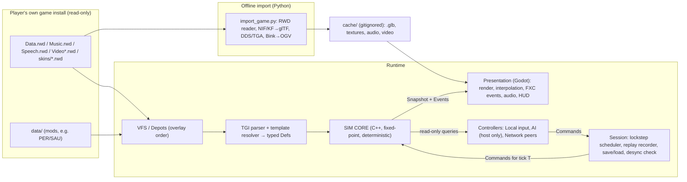

# Architecture

Working name: **Project Corps**. This is a placeholder. Don't use "Axis & Allies" in a public project name because Hasbro owns the trademark.

This is a **reimplementation of the 2004 TimeGate RTS engine** that reads the original game's data (models, textures, TGI rules) from the player's own installed copy. The model is the same one OpenMW, OpenRA and OpenTTD use: the repository contains only our code and tools. Game assets are never committed or redistributed (see [ASSET_PIPELINE.md](ASSET_PIPELINE.md#legal-model-bring-your-own-data)).

Related docs: [GAME_DESIGN.md](GAME_DESIGN.md), [PATHFINDING.md](PATHFINDING.md), [AI.md](AI.md), [NETCODE.md](NETCODE.md), [ASSET_PIPELINE.md](ASSET_PIPELINE.md), [MILESTONES.md](MILESTONES.md).

---

## 1. What we learned from the original (evidence)

| Observation | Where | Consequence for us |
|---|---|---|
| All gameplay is **data-driven text (TGI)** with template inheritance (`[Thing Template=AAUnitPERVehicleMediumTank]`), loaded in the order set by `index*.lst` | `data/index_aa.lst`, `data/templates_AA.lst`, every `*.tgi` | Build a **TGI parser and template resolver** and use the original data as the rules source. Faithfulness then comes for free, and existing mods (the PER/SAU nations) work. |
| Numeric data type `fixed` everywhere; log shows `KKC_FixedPointDataValue` pools | `resource_list.tgi`, `SVars_AA.tgi`, `Logs/log-9-ok.log` | The original sim was **fixed-point**, which is the classic sign of deterministic lockstep. We do the same. |
| Replays (`.RFM` "films") and `LAST FILM.RFM` are auto-saved for every game | `Readme.txt` | The original was **command-stream lockstep**. The netcode and replays follow the same model ([NETCODE.md](NETCODE.md)). |
| Multiplayer uses UDP 6900/5860, and lag scales with players, regiments and AI players | `Readme.txt` | Same topology class. Keep AI cheap on the host. |
| Actors are built from **components**: `BodyComponent`, `MoverComponent`, `PerformerComponent` (abilities, turrets), `EconomyComponent`, `OrganizationComponent` (regiment slots), `MobileDeploymentComponent` (pack/unpack), `RecruitComponent`, `ResearchComponent`, `SupplyComponent`, `DetectionComponent`, `DefenderComponent`, `PropertiesComponent`, `SettlementComponent` | `Templates/Components/*.tgi`, unit/building TGIs | Our entity model **mirrors these components 1:1**, so TGI blocks map directly onto sim components. |
| Presentation hooks are declared in data as `WhenDo`, `WhenCreated`, `WhenDestroyed`, `WhenSelected` etc. → `FXC_PlaySFX`, `FXC_CreateVFX`, `FXC_PlayObjectAnimation`, `FXC_Equipment` | unit TGIs, log pools `KKC_FXC*` | The sim emits typed **events**, and the presentation layer runs the FXC lists from data. |
| A **depot** (virtual filesystem) system layers `Data.rwd` → `data/` → user folder, with later depots overriding earlier ones | `startup/autoexec.txt` | Our VFS uses the same overlay order. This is how the `data/` PER/SAU clones override and extend `Data.rwd`. |
| Class prefixes `KKC_`/`KKS_` and SVars comments like "bigger than in K2" | logs, `SVars_AA.tgi` | The engine is TimeGate's **Kohan II-era RTS engine** (inferred). Kohan II mechanics (supply zones, regiment companies, morale/rout, ZOC) apply. |
| Models are **Gamebryo NIF 10.1.0.0**, animations are **KF** (`NiControllerSequence`), textures are **DXT5 DDS** | verified by parsing (see ASSET_PIPELINE) | Convert offline to glTF. Godot loads DDS natively. |

---

## 2. Technology choices

| Layer | Choice | Why |
|---|---|---|
| Engine / renderer / UI / audio | **Godot 4.x** (pin the latest stable at project start) | Free, glTF-native, imports DDS, good 2D UI for the RTS HUD, easy scripting in GDScript (similar to Python). |
| Simulation core | **C++20 static library** with no Godot dependency, exposed to Godot through **GDExtension (godot-cpp)** | Determinism needs full control of integer math, memory layout and iteration order, plus the speed to run around 1,300 units and pathfinding at 10 Hz. It also builds as a **headless CLI** for tests, replays, desync bisection and AI-vs-AI soak runs. |
| Gameplay glue, UI, camera, input, FX | **GDScript** | Fast iteration. None of it affects the sim's outcome. |
| AI controllers | **GDScript first**, moving hot paths to C++ if needed | AI runs only on the host and emits commands ([AI.md](AI.md)), so it **does not need to be deterministic**. |
| Tools (archive reader, NIF→glTF, data dumps) | **Python 3** (+ the existing PowerShell scripts) | Already proven: `pyffi` parses the NIF/KF files. |
| Build | CMake for the sim lib and tests, SCons/CMake for the GDExtension, Godot export templates | Standard. |
| Tests | doctest/Catch2 (C++), GUT (GDScript, optional), pytest (tools) | |
| Networking | ENet through Godot's **low-level** `ENetConnection`/`PacketPeer` API, not the high-level RPC/MultiplayerSynchronizer | Lockstep sends commands, not replicated state ([NETCODE.md](NETCODE.md)). |

---

## 3. The big picture



### Hard boundary: sim vs view

* The **sim** is a pure function: `State(T+1) = Step(State(T), Commands(T))`. It never calls Godot, never reads the clock, never uses `float`/`double`, and never iterates hash containers in unspecified order.
* The **view** reads the sim through a **read-only snapshot API** and **interpolates** positions and orientations between the last two ticks for smooth 60+ fps rendering.
* Everything the player does becomes a **Command** (`MoveRegiment`, `SetFormation`, `Deploy`, `Unpack`, `Recruit`, `Research`, `UseSpecialOp`, ...). Commands are the only way to change the sim. That makes replays, multiplayer and AI the same thing.

---

## 4. Runtime modules

### 4.1 VFS / Depots (`sim/vfs`, also used by the view)
* Mount order copied from `startup/autoexec.txt`: `Data.rwd` → `data/` → `Music.rwd` → `Speech.rwd` (locale) → user overlay (`%USERDATA%/data`, `Userdata/`). **Later mounts win.**
* `RwdArchive` reads the TGCK format (documented in [ASSET_PIPELINE.md §2](ASSET_PIPELINE.md#2-rwd-archive-format-tgck)), with case-insensitive paths and `/` separators.
* Works directly on the `.rwd` files, so you don't need `_rwd_extract/`. That folder stays useful for browsing.

### 4.2 Data layer: TGI → Defs (`sim/data`)
* **Lexer/parser** for TGI: sections `[Type Template=X] { ... }`, flat sections without braces (e.g. `[BodyComponent] health = 200`), `key = value`, typed template declarations (`fixed`, `int`, `float`, `bool`, `flag`, `string`, `point2`, `point3`, `[list X Template=Y]`), comments `;`, `;;`, `/* */`, localized refs `"#ids"`, Windows-1252 encoding, case-insensitive keys (`IDS`/`ids`, `Template`/`template`).
* **Loader** follows `index*.lst` (alphabetical, wildcards, nested `.lst` processed in place). Templates must load before data.
* **Template resolver** builds the inheritance chain and applies overrides: scalars replace, `[list]` children append, named children deep-merge, and a child that names its own `template=` rebases. Templates bind in load order. The full grammar, rules and edge cases are in [TGI_FORMAT.md](TGI_FORMAT.md).
* **Def compiler** turns the resolved node tree into **typed, immutable C++ structs** (`UnitDef`, `RegimentDef`, `BuildingDef`, `AbilityDef`, `ResearchDef`, `NationDef`, `GeneralDef`, `SpecialOpDef`, `RmcDef`, `SVars`, `WorldRules`...). Numbers marked `fixed` become fixed-point at compile time.
* A **data hash** over the compiled defs is used for multiplayer and replay compatibility checks.
* **Implemented (M3):** `sim/data/def_compiler` produces `UnitDef` (categories `UNIT` and `TRUCK`), `RegimentDef` (category `ORGANIZATION`), `BuildingDef` (`BUILDING`), `AbilityDef` (top-level, plus every inline `PerformerComponent/Ability` as `<owner>#<n>`), `NationDef` and `SVarsDef`, all with Fixed numbers.
  * Regiment slots resolve to a unit/truck or a building. An unpacked HQ regiment's slot holds the HQ building itself.
  * Other categories (doodads, effects, metagame, trailers…) aren't compiled yet; `simcli show-def` prints the category histogram.
  * `dataHash = xxh3_64(serializeDefs(defs))`.
* Unknown keys are kept and logged rather than dropped, so we can find what we haven't implemented yet (`--report-unknown`).

### 4.3 Simulation core (`sim/`)
**Data-oriented ECS-lite** (`sim/ecs`).
* **`EntityId`** is 32 bits: a 12-bit generation (high) and a 20-bit index (low). Generations start at 1, so 0 is the null id.
* **Destruction** is deferred to the Cleanup stage. The freed index then goes to the back of a FIFO free list.
* **Retirement:** a slot whose generation would wrap past 4095 is retired, never reused, so a stale id can't alias a newer entity.
* **Pools:** each component lives in a sparse-set pool whose dense arrays stay sorted by entity index. A plain walk is therefore always **ascending EntityId** (deterministic).
* **Current components:** `Transform`, `DefRef`, `Health` and `Member`. More arrive with their systems.

Components mirror the original:

| Our component | Original TGI block | Key fields |
|---|---|---|
| `Body` | `BodyComponent` | health, defense, damage resistances, `Size` (blocking shape) |
| `Mover` | `MoverComponent` | speed_max, acceleration, movement class, trailer |
| `Performer` | `PerformerComponent` | abilities (turreted or local), turret yaw rates, attack_height, cv_bias |
| `Economy` | `EconomyComponent` | Cost, Upkeep, Production lists |
| `Organization` | `OrganizationComponent` | layout_ids, slots (element ids), formation, morale, xp, combat efficiency |
| `Element` | `ElementComponent` | parent organization, slot index, required structures/properties |
| `MobileDeployment` | `MobileDeploymentComponent` | unpack_to, pack/unpack timers, pack_health_min |
| `Recruit` | `RecruitComponent` | recruitable organization ids, queue |
| `Research` | `ResearchComponent` | research items, progress |
| `Supply` | `SupplyComponent` | zone radius, active/under-siege |
| `Detection` | `DetectionComponent` | sight radii, detect hidden |
| `Defender` | `DefenderComponent` | control_range, built-in turret abilities |
| `Properties` | `PropertiesComponent` | set of property ids (tags and modifiers) |
| `Settlement` | `SettlementComponent` | cities: capture, level, structures |
| `Kingdom` (per player) | n/a | resources, limits, army XP, general, tech, team |

**Fixed tick order (10 Hz, 100 ms per tick).** It never changes at runtime:

1. **Apply commands** for this tick, sorted by player id, then sequence, then position in the bundle. `Sim::step(commands)` receives exactly one tick's commands. The **CommandQueue** that holds future commands belongs to the session (replay player, lockstep scheduler), not to the sim. Peers receive future bundles at different times, so future commands must not be part of the hashed state. A command for any other tick is rejected deterministically.
2. **Economy**: production, upkeep, oil/ammo shortfall → money conversion, limits.
3. **Construction / pack / unpack / recruit / research** timers.
4. **Orders → plans**: regiment/group order state machines (move, attack, guard, run, retreat).
5. **Pathfinding service**: process the request queue with a fixed node-expansion budget ([PATHFINDING.md](PATHFINDING.md)).
6. **Movement**: regiment anchor advance, formation slots, unit steering and local avoidance.
7. **Vision / fog**: per-team visibility grid.
8. **Engagement & targeting**: ZOC checks, engagement state machine, target selection.
9. **Abilities**: fire, spawn projectiles, apply effects/damage.
10. **Morale / experience / entrenchment / combat efficiency** blending.
11. **Supply & healing / replacement**, under-siege flags.
12. **Capture, objectives, victory** (`game_events`).
13. **Cleanup** (deaths → events), then the **state hash** (every N ticks).

Events (`UnitFired`, `UnitDied`, `RegimentRouted`, `BuildingPacked`, ...) are appended to a per-tick buffer that the view drains.

**Math library (`sim/math`, M3).**
* **`Fixed`:** Q32.32 in `int64`, range ±2³¹, resolution 2⁻³².
  * Multiply and divide use 128-bit intermediates (`math/int128.hpp`). There's a portable constexpr version; fast paths use `__int128` on GCC/Clang or `_umul128`/`_udiv128` on MSVC x64, and clang-cl divides portably. A test checks the fast and portable paths give identical bits.
  * **Rounding:** multiply rounds half up; divide rounds to nearest, ties away from zero.
  * **Overflow:** results **saturate** to min/max. Division by zero gives ±max (0/0 gives 0). There's no signed-overflow undefined behaviour anywhere.
  * Saturations are counted for diagnostics only; the sim never reads the count.
  * `1.5_fx` literals are parsed from their characters at compile time, never as a float.
* **`isqrt64`/`isqrt128`** give the exact floor square root; Fixed `sqrt` is built on them.
* **`Angle`** is a 16-bit binary angle (65536 = one full turn).
  * `sin`/`cos` use a 4,097-entry quarter-wave table with linear interpolation (error about 2·10⁻⁸).
  * `atan2` folds the input into one octant and uses a 4,097-entry arctan table. It inverts sin/cos to within 1 unit for all 65,536 angles.
  * The tables (`math/trig_tables.inc`) come from `tools/gen_trig_tables.py`, which uses exact decimal arithmetic (no libm). CTest checks the committed tables are current.
* **`FVec2`:** dot and cross accumulate in 128 bits and round once. `length()` works for every representable vector.
* **`Rng`** is PCG32 (pcg32_random_r; the reference vector is a test).
  * **One stream is owned by the sim**, derived from the match seed. Per-system sub-streams are `Rng::derive(matchSeed, streamId)` with fixed `RngStream` ids, so adding a system never shifts another system's draws.
  * Bounded draws use Lemire's unbiased method.
* **Cross-platform check:** a fixed checksum over 10k mixed operations must match on every compiler and build type.

**Canonical state, replays and determinism tooling (`sim/session`, M3).**
* **`saveState`/`loadState`:** one byte layout (format v3) used for the state hash, saves and desync dumps. It holds the header (tick, seed, data hash, map hash, RNG), the entity registry, each component pool by ascending id (Transform, DefRef, Health, Member, Footprint, Path, Regiment, Order, Mover, Group), then the nav section: graph version, clusters dirty since the last rebuild, and the PathService queue and suspended job. The nav grid and HPA* graph are not stored; loading rebuilds them from the map and the live footprints. **The state hash is `xxh3_64`** of those bytes; xxHash 0.8.2 is vendored in `third_party/`.
* **Replays (`.rpl`):** header (sim version = git tree hash of `sim/`, data hash, seed), commands, and `(tick, hash)` every 10 ticks, followed by an integrity hash.
* **`simcli` commands:** `record` / `play` / `determinism-check [--every-tick] [--per-stage]`. The determinism check runs the replay twice from fresh Sims and compares per-tick hashes, and per-stage hashes with `--per-stage`. It also compares against the hashes stored in the file, which may come from another build or OS. A committed synthetic fixture (`sim/tests/fixtures/synthetic_300.rpl`) is replayed on every CI job.
* **Tick rate:** we run **10 Hz** as specified here and in NETCODE. The original's `SVars` says `GameTicksPerGameSecond = 16`. It's one constant (`kTicksPerSecond`), so it can change before movement (M4) bakes in per-tick numbers.
* The sim is **2D**: the ground plane (x, y). Height is view-only (terrain heightmap sampling for rendering). Air units carry a layer flag, not a z coordinate.

### 4.4 Presentation (`godot/`)
* `SimBridge` (GDExtension class) owns the sim instance and exposes `step(commands)`, `snapshot()` and `drain_events()`.
* **Render interpolation**: `alpha = time_since_tick / tick_len`, and the view lerps between prev and curr positions (the snapshot keeps both).
* **ActorView** per entity: instanced from the cached `.glb` resolved by `resource_prefix`, with skins per biome (`Arctic/`, `Desert/` subfolders) and per nation.
* **FXC runner**: runs the data-declared FXC lists for events (`FXC_PlaySFX`, `FXC_CreateVFX`, `FXC_PlayObjectAnimation`, `FXC_Equipment`, `FXC_ChangeSkin`...). Each FXC type is a small GDScript handler.
* **HUD**: stats bar (money reserve, +income, oil, ammo, unit limit, building limit), operations bar (army XP, special ops), command panel, info panel (regiment banner, health/morale/efficiency bars), minimap, message log, team commands and flares. The original UI art is in `_rwd_extract/UI/` and can be used directly.
* **Camera**: RTS camera (pan, edge scroll, zoom, rotate), with selection by click, box and double-click (same type).

**Implemented (M4 part 3)** in `gdext/sim_bridge.*` and `godot/scripts/battle/`, scene `res://scenes/battle.tscn` (the main scene):

* **SimBridge** owns the game data (VFS, TGI database, DefSet), the MapDef and the Sim.
  * **Set-up and static data:** `start(game_dir, map_spec, seed)`, `map_info()` (size, view heights, terrain names and per-cell terrain/kind), `terrain_table(biome)`, `unit_visual(def)`, `regiment_def(def)`, `find_open_area()`.
    * `terrain_table` gives every TGI `Terrain` variation's texture (relative to its record's folder), data colour and repeat size.
    * `unit_visual` gives the cache model path: `resource_prefix` relative to the unit's TGI folder, `.glb`.
  * **Commands:** `queue_*` for spawn, move (Run, explicit facing), stop, formation, group behaviour and debug blockers. Queued commands are applied by the next `step()`. Selections over six regiments are sent as several groups.
  * **Reading:** `snapshot()` returns parallel packed arrays per entity: id, kind, def, organization, player, moving, and previous and current position and facing. `drain_events()`, and the debug queries `regiment_info()` (state, formation, compression, slot targets, path) and `cost_grid(class)`.
  * Floats exist only on the bridge's side. Everything handed to the sim is `Fixed`, and the view can't reach sim state except through commands.
* **Loop:** `battle.gd` steps the sim at 10 Hz from an accumulator (up to 8 ticks per frame; Space pauses; +/- changes speed) and renders at `alpha = accum / 0.1` between the snapshot's previous and current transforms.
* **Terrain** (`terrain.gd`, `terrain.gdshader`):
  * Mesh: a heightfield from the map's view heights. Generated test maps get a small relief from their terrain kinds.
  * Texturing: one `Texture2DArray` layer per used variation (the original `.tga` from `cache/Terrain/...`, or the data colour when missing), picked per 2-unit tile and blended across tile borders. Each repeats every `texture_width` tiles.
  * Water: a translucent plane at the median land height − 0.25 over water.
  * Not yet: the original transition and edge textures, detail and macro textures, animated water.
* **Units** (`unit_views.gd`):
  * One prototype per UnitDef from the cached `.glb`, with hidden helper nodes (e.g. `SelectionBox`) hidden.
  * Walk/Jog/Idle clips from `compatible_clips`, retargeted once per prototype and shared by every instance's AnimationPlayer.
  * Facing: sim θ → `rotation.y = -θ`, and imported models face Godot +Z, so the model is turned by +90°.
  * Not yet: biome and nation skins, death and attack animations, FXC.
* **Camera** (`rts_camera.gd`): pan with the arrows or the screen edges, zoom with the wheel, rotate with middle drag or PgUp/PgDn, Home resets. Fixed 52° pitch.
* **Input:**
  * **Selection:** left click picks the regiment of the nearest own unit (24 px); box drag; Shift adds; double-click selects all visible own regiments of that RegimentDef; Ctrl+1..9 stores the selection, 1..9 recalls it (tap twice to jump the camera).
  * **Orders:** right click moves, right drag moves with a facing, Alt+right click runs. Q/W/E set Assault/Normal/Column, V toggles group behaviour, S stops, B drops a debug blocker.
* **Debug overlays:** F1 cost grid of the selected regiment's class (red blocked, green normal, blue roads, yellow/orange slower), F2 paths (remaining part bright), F3 slot targets with anchors and headings, F4 HUD (tick, fps, the selection's formation, state, group and compression, recent arrival/blocked events).
* **Checks:** `godot --path godot -- --selftest` drives the controls with synthetic input events and prints PASS/FAIL:
  * click, Shift-click, double-click, box, Ctrl+1/1;
  * Q/E formations, right-click move to the clicked ground point, Alt+right-click Run;
  * F1–F3 overlays, and one view per unit.
  `--screenshot=PATH --frames=N` renders a frame and quits.
* **Open:**
  * The Release GDExtension now links: the root CMakeLists strips godot-cpp's hardcoded `/MDd`, which it applies whenever `CMAKE_BUILD_TYPE` is empty, as with Visual Studio. But the debug editor binary crashes with it after spawning (heap free, signal 11). Likely cause: godot-cpp defines `DEBUG_ENABLED` and `DEBUG_METHODS_ENABLED` only in its Debug config, so the Release extension is a template_release build. The editor and `godot --path` load the Debug DLL, which works.
  * Battle view fps (M4 close-out, dev laptop, HD 3000 through ANGLE, 1280×720, gen:7:1024):
    * 160 regiments (1,060 units): 9.3 fps with the sim paused (frame 108 ms).
    * 6 regiments (40 units): 13.1 fps (frame 76 ms).
    * Rendering the scene, not the units, dominates on this GPU; each unit adds about 0.03 ms.
    * With the sim running in the Debug DLL: 7.5 fps, of which the Debug sim takes about 140 ms per tick (Release: about 3.6 ms).
    * This laptop is far below the §7 target PC.
  * Loading the TGI data through the Debug build takes 15–30 s on the dev laptop.
  * The dev laptop's GPU (HD 3000) has no Vulkan or D3D12, so Godot runs the GL Compatibility renderer through ANGLE, at about 10 fps with 70 units.

### 4.5 Controllers
* `LocalPlayerController`: input → Commands (hotkeys from `Localization/Hotkeys/*.txt`).
* `AIController` ([AI.md](AI.md)): reads the sim through the same read-only API, filtered by fog for its team, and emits Commands. It runs on the host.
* `RemotePeer`: commands arriving over the network.

### 4.6 Session
* `LockstepScheduler` ([NETCODE.md](NETCODE.md)): gathers commands for tick T+delay, advances only when tick T's bundle is complete, and stays in step with real time.
* `ReplayRecorder` / `ReplayPlayer`: header (versions, data hash, seed, settings, players) plus the command stream.
* `SaveGame`: full sim serialization (canonical byte order, stable ordering). Saving and loading must reproduce the identical state hash.
* `DesyncDetector`: hash exchange, and dumps state on mismatch.

---

## 5. Repository layout

```
Remake/                         ← this repo (move it out of the game folder whenever you like)
  CLAUDE.md                     ← rules for Claude Code sessions
  README.md
  docs/                         ← these design docs
  sim/                          ← C++20, NO Godot headers allowed
    math/  core/  data/  vfs/  ecs/  systems/  nav/  session/
    tests/
  simcli/                       ← headless runner: replay, hash, soak, defs dump
  gdext/                        ← godot-cpp bindings (SimBridge)
  godot/                        ← Godot project
    project.godot
    scenes/  scripts/  ui/  fxc/  ai/  net/
  tools/                        ← Python: rwd.py, nif2gltf.py, import_game.py, tgi_dump.py
  cache/                        ← GENERATED from the player's game install, gitignored
  config/game_path.cfg          ← where the original install lives, gitignored
```

---

## 6. Cross-cutting rules (also in CLAUDE.md)

1. **No floats in `sim/`.** CI greps for `float`/`double` in `sim/` and fails if it finds any (outside `// view-only` debug helpers that are compiled out).
2. **No Godot headers in `sim/`.** The sim must build and run in `simcli` alone.
3. **No unordered iteration** in `sim/`. Use `std::vector` plus sorted ids, or a deterministic open-addressing map with insertion-order iteration.
4. **No wall clock, threads or `rand()` in `sim/`.** Parallelism is allowed only for work that writes to disjoint, pre-allocated slots and is reduced in a fixed order (not before M8).
5. **Never commit game assets.** `.gitignore` blocks `*.rwd *.nif *.kf *.dds *.tga *.bik` and `cache/`.
6. Every new sim feature needs a **determinism test**: run a recorded replay twice (and in Debug vs Release) and compare per-tick hashes.

---

## 7. Performance budget (target PC: mid-range 2020 laptop)

| Item | Budget |
|---|---|
| Worst case | 8 kingdoms × 20 regiments × up to 8 units ≈ **1,300 units** plus about 300 buildings and projectiles |
| Sim tick (10 Hz) | ≤ **15 ms** at the 99th percentile on one core (≈15% of the tick period). M4: 10.7 ms p99 with 160 regiments on a 1024² map (PATHFINDING §10) |
| Pathfinding | ≤ 3 ms per tick budgeted, the rest amortized |
| Render | 60 fps at 1080p. Use MultiMesh instancing for infantry where possible, and LOD on distant units. |
| Memory | < 2 GB |

---

## 8. Risks & mitigations

| Risk | Mitigation |
|---|---|
| Exact combat formulas are inside `AA.exe`, not in data | Build a **calibration harness**: set up identical 1v1 regiment fights in the original (editor maps) and in ours, measure time-to-kill and survivors, and tune the formula until they match within tolerance. See GAME_DESIGN §6. |
| Map binary format not yet identified (only string tables extracted so far) | Start with **RMC-driven random maps** (the RMC data is plain TGI). Reverse the map format later (M10). |
| Skinned biped animation conversion | pyffi already parses `NiSkinInstance`/`NiSkinData` and KF. Convert the Bip01 skeleton to a glTF skin, with one clip per KF. |
| Determinism bugs | Fixed-point everywhere, hash every 10 ticks in debug builds, and `simcli bisect` to find the first divergent tick and system. |
| Scope creep (WWII metagame, campaigns, naval, air) | Vertical slice first ([MILESTONES.md](MILESTONES.md)). Everything else is data plus incremental systems. |
