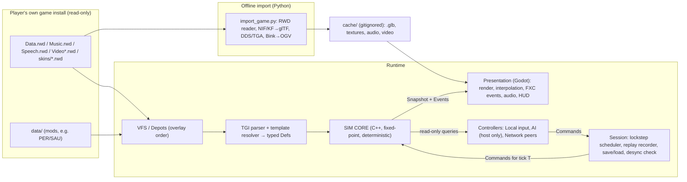

# Architecture

Working name: **Project Corps**. This is a placeholder. Don't use "Axis & Allies" in a public project name because Hasbro owns the trademark.

This is a **reimplementation of the 2004 TimeGate RTS engine** that reads the original game's data (models, textures, TGI rules) from the player's own installed copy. The model is the same one OpenMW, OpenRA and OpenTTD use: the repository contains only our code and tools. Game assets are never committed or redistributed (see [ASSET_PIPELINE.md](ASSET_PIPELINE.md#legal-model-bring-your-own-data)).

Related docs: [GAME_DESIGN.md](GAME_DESIGN.md), [PATHFINDING.md](PATHFINDING.md), [AI.md](AI.md), [NETCODE.md](NETCODE.md), [ASSET_PIPELINE.md](ASSET_PIPELINE.md), [MILESTONES.md](MILESTONES.md).

---

## 1. What we learned from the original (evidence)

| Observation | Where | Consequence for us |
|---|---|---|
| All gameplay is **data-driven text (TGI)** with template inheritance (`[Thing Template=AAUnitPERVehicleMediumTank]`), loaded in the order set by `index*.lst` | `data/index_aa.lst`, `data/templates_AA.lst`, every `*.tgi` | Build a **TGI parser and template resolver** and use the original data as the rules source. Faithfulness then comes for free, and existing mods (the PER/SAU nations) work. |
| Numeric data type `fixed` everywhere; log shows `KKC_FixedPointDataValue` pools | `resource_list.tgi`, `SVars_AA.tgi`, `Logs/log-9-ok.log` | The original sim was **fixed-point**, which is the classic sign of deterministic lockstep. We do the same. |
| Replays (`.RFM` "films") and `LAST FILM.RFM` are auto-saved for every game | `Readme.txt` | The original was **command-stream lockstep**. The netcode and replays follow the same model ([NETCODE.md](NETCODE.md)). |
| Multiplayer uses UDP 6900/5860, and lag scales with players, regiments and AI players | `Readme.txt` | Same topology class. Keep AI cheap on the host. |
| Actors are built from **components**: `BodyComponent`, `MoverComponent`, `PerformerComponent` (abilities, turrets), `EconomyComponent`, `OrganizationComponent` (regiment slots), `MobileDeploymentComponent` (pack/unpack), `RecruitComponent`, `ResearchComponent`, `SupplyComponent`, `DetectionComponent`, `DefenderComponent`, `PropertiesComponent`, `SettlementComponent` | `Templates/Components/*.tgi`, unit/building TGIs | Our entity model **mirrors these components 1:1**, so TGI blocks map directly onto sim components. |
| Presentation hooks are declared in data as `WhenDo`, `WhenCreated`, `WhenDestroyed`, `WhenSelected` etc. → `FXC_PlaySFX`, `FXC_CreateVFX`, `FXC_PlayObjectAnimation`, `FXC_Equipment` | unit TGIs, log pools `KKC_FXC*` | The sim emits typed **events**, and the presentation layer runs the FXC lists from data. |
| A **depot** (virtual filesystem) system layers `Data.rwd` → `data/` → user folder, with later depots overriding earlier ones | `startup/autoexec.txt` | Our VFS uses the same overlay order. This is how the `data/` PER/SAU clones override and extend `Data.rwd`. |
| Class prefixes `KKC_`/`KKS_` and SVars comments like "bigger than in K2" | logs, `SVars_AA.tgi` | The engine is TimeGate's **Kohan II-era RTS engine** (inferred). Kohan II mechanics (supply zones, regiment companies, morale/rout, ZOC) apply. |
| Models are **Gamebryo NIF 10.1.0.0**, animations are **KF** (`NiControllerSequence`), textures are **DXT5 DDS** | verified by parsing (see ASSET_PIPELINE) | Convert offline to glTF. Godot loads DDS natively. |

---

## 2. Technology choices

| Layer | Choice | Why |
|---|---|---|
| Engine / renderer / UI / audio | **Godot 4.x** (pin the latest stable at project start) | Free, glTF-native, imports DDS, good 2D UI for the RTS HUD, easy scripting in GDScript (similar to Python). |
| Simulation core | **C++20 static library** with no Godot dependency, exposed to Godot through **GDExtension (godot-cpp)** | Determinism needs full control of integer math, memory layout and iteration order, plus the speed to run around 1,300 units and pathfinding at 10 Hz. It also builds as a **headless CLI** for tests, replays, desync bisection and AI-vs-AI soak runs. |
| Gameplay glue, UI, camera, input, FX | **GDScript** | Fast iteration. None of it affects the sim's outcome. |
| AI controllers | **GDScript first**, moving hot paths to C++ if needed | AI runs only on the host and emits commands ([AI.md](AI.md)), so it **does not need to be deterministic**. |
| Tools (archive reader, NIF→glTF, data dumps) | **Python 3** (+ the existing PowerShell scripts) | Already proven: `pyffi` parses the NIF/KF files. |
| Build | CMake for the sim lib and tests, SCons/CMake for the GDExtension, Godot export templates | Standard. |
| Tests | doctest/Catch2 (C++), GUT (GDScript, optional), pytest (tools) | |
| Networking | ENet through Godot's **low-level** `ENetConnection`/`PacketPeer` API, not the high-level RPC/MultiplayerSynchronizer | Lockstep sends commands, not replicated state ([NETCODE.md](NETCODE.md)). |

---

## 3. The big picture



### Hard boundary: sim vs view

* The **sim** is a pure function: `State(T+1) = Step(State(T), Commands(T))`. It never calls Godot, never reads the clock, never uses `float`/`double`, and never iterates hash containers in unspecified order.
* The **view** reads the sim through a **read-only snapshot API** and **interpolates** positions and orientations between the last two ticks for smooth 60+ fps rendering.
* Everything the player does becomes a **Command** (`MoveRegiment`, `SetFormation`, `Deploy`, `Unpack`, `Recruit`, `Research`, `UseSpecialOp`, ...). Commands are the only way to change the sim. That makes replays, multiplayer and AI the same thing.

---

## 4. Runtime modules

### 4.1 VFS / Depots (`sim/vfs`, also used by the view)
* Mount order copied from `startup/autoexec.txt`: `Data.rwd` → `data/` → `Music.rwd` → `Speech.rwd` (locale) → user overlay (`%USERDATA%/data`, `Userdata/`). **Later mounts win.**
* `RwdArchive` reads the TGCK format (documented in [ASSET_PIPELINE.md §2](ASSET_PIPELINE.md#2-rwd-archive-format-tgck)), with case-insensitive paths and `/` separators.
* Works directly on the `.rwd` files, so you don't need `_rwd_extract/`. That folder stays useful for browsing.

### 4.2 Data layer: TGI → Defs (`sim/data`)
* **Lexer/parser** for TGI: sections `[Type Template=X] { ... }`, flat sections without braces (e.g. `[BodyComponent] health = 200`), `key = value`, typed template declarations (`fixed`, `int`, `float`, `bool`, `flag`, `string`, `point2`, `point3`, `[list X Template=Y]`), comments `;`, `;;`, `/* */`, localized refs `"#ids"`, Windows-1252 encoding, case-insensitive keys (`IDS`/`ids`, `Template`/`template`).
* **Loader** follows `index*.lst` (alphabetical, wildcards, nested `.lst` processed in place). Templates must load before data.
* **Template resolver** builds the inheritance chain and applies overrides: scalars replace, `[list]` children append, named children deep-merge, and a child that names its own `template=` rebases. Templates bind in load order. The full grammar, rules and edge cases are in [TGI_FORMAT.md](TGI_FORMAT.md).
* **Def compiler** turns the resolved node tree into **typed, immutable C++ structs** (`UnitDef`, `RegimentDef`, `BuildingDef`, `AbilityDef`, `ResearchDef`, `NationDef`, `GeneralDef`, `SpecialOpDef`, `RmcDef`, `SVars`, `WorldRules`...). Numbers marked `fixed` become fixed-point at compile time.
* A **data hash** over the compiled defs is used for multiplayer and replay compatibility checks.
* **Implemented (M3):** `sim/data/def_compiler` produces `UnitDef` (categories `UNIT` and `TRUCK`), `RegimentDef` (category `ORGANIZATION`), `BuildingDef` (`BUILDING`), `AbilityDef` (top-level, plus every inline `PerformerComponent/Ability` as `<owner>#<n>`), `NationDef` and `SVarsDef`, all with Fixed numbers.
  * Regiment slots resolve to a unit/truck or a building. An unpacked HQ regiment's slot holds the HQ building itself.
  * Other categories (doodads, effects, metagame, trailers…) aren't compiled yet; `simcli show-def` prints the category histogram.
  * `dataHash = xxh3_64(serializeDefs(defs))`.
  * **Combat data (M5 part 1):**
    * Units and buildings get `weapons` (one per Ability slot: ability, priority, fuzzy range, reload, turret) and `turrets` (yaw rate and range, rest yaw, reset time). Buildings also read their `DefenderComponent` slots and `control_range`.
    * `AbilityDef` gains `max_targets`, `volley_area`, attenuation and a resolved projectile.
    * New defs: `DamageTypeDef`, `TargetTypeDef`, `PropertyDef` (resistances, DV, target flags, required properties), `TerrainDef` (group, properties, variation names) and `ProjectileDef` (speed, type, life).
    * `simcli show-def` prints all of them.
  * **Morale and experience data (M5 part 2):**
    * Units and buildings: `morale_value`.
    * Regiments: `ExperienceComponent` levels (threshold, AV, DV, HEALTH, MORALE, MORALE_RECOVERY_RATE) and `fake_cv_value`.
    * Layouts: the resolved retreat formation.
    * Properties: their attribute modifiers (`ModifierDef`: ADD or MULTIPLY on an attribute).
* Unknown keys are kept and logged rather than dropped, so we can find what we haven't implemented yet (`--report-unknown`).

### 4.3 Simulation core (`sim/`)
**Data-oriented ECS-lite** (`sim/ecs`).
* **`EntityId`** is 32 bits: a 12-bit generation (high) and a 20-bit index (low). Generations start at 1, so 0 is the null id.
* **Destruction** is deferred to the Cleanup stage. The freed index then goes to the back of a FIFO free list.
* **Retirement:** a slot whose generation would wrap past 4095 is retired, never reused, so a stale id can't alias a newer entity.
* **Pools:** each component lives in a sparse-set pool whose dense arrays stay sorted by entity index. A plain walk is therefore always **ascending EntityId** (deterministic).
* **Current components:**
  * M3: `Transform`, `DefRef`, `Health`, `Member`.
  * M4: `Footprint`, `Path`, `Regiment`, `Order`, `Mover`, `Group`.
  * M5: `Combat` (per weapon: target, cooldown; per turret: yaw, idle time; the target a local gun turns the body to), `Engagement` (a regiment's engagement state machine, Attack / AttackMove, the move it put on hold; part 2 adds morale, actual efficiency, XP and level, the entrenchment timer and its last attacker) and `Projectile` (a shot in flight).
  * Per player (not a pool): `World::kingdoms`, each active or not and with its army XP (M5 part 2); M6: started, money, bankrupt, and the properties its GLOBAL research granted.
  * M6 part 1: `Structure` (a player building: deployed / unpacking / packing and its timer, its HQ regiment's XP, LOCAL research, the recruit queue with the regiment being filled, the research in progress) and `Deploy` (a truck regiment driving to unpack: building, centre, facing).
  * More arrive with their systems.

Components mirror the original:

| Our component | Original TGI block | Key fields |
|---|---|---|
| `Body` | `BodyComponent` | health, defense, damage resistances, `Size` (blocking shape) |
| `Mover` | `MoverComponent` | speed_max, acceleration, movement class, trailer |
| `Performer` | `PerformerComponent` | abilities (turreted or local), turret yaw rates, attack_height, cv_bias |
| `Economy` | `EconomyComponent` | Cost, Upkeep, Production lists |
| `Organization` | `OrganizationComponent` | layout_ids, slots (element ids), formation, morale, xp, combat efficiency |
| `Element` | `ElementComponent` | parent organization, slot index, required structures/properties |
| `MobileDeployment` | `MobileDeploymentComponent` | unpack_to, pack/unpack timers, pack_health_min |
| `Recruit` | `RecruitComponent` | recruitable organization ids, queue |
| `Research` | `ResearchComponent` | research items, progress |
| `Supply` | `SupplyComponent` | zone radius, active/under-siege |
| `Detection` | `DetectionComponent` | sight radii, detect hidden |
| `Defender` | `DefenderComponent` | control_range, built-in turret abilities |
| `Properties` | `PropertiesComponent` | set of property ids (tags and modifiers) |
| `Settlement` | `SettlementComponent` | cities: capture, level, structures |
| `Kingdom` (per player) | n/a | resources, limits, army XP, general, tech, team |

**Fixed tick order (10 Hz, 100 ms per tick).** It never changes at runtime:

1. **Apply commands** for this tick, sorted by player id, then sequence, then position in the bundle. `Sim::step(commands)` receives exactly one tick's commands. The **CommandQueue** that holds future commands belongs to the session (replay player, lockstep scheduler), not to the sim. Peers receive future bundles at different times, so future commands must not be part of the hashed state. A command for any other tick is rejected deterministically.
2. **Economy**: production, upkeep, oil/ammo shortfall → money conversion, limits.
   * Implemented in M6 part 1 (`sim/systems/economy.*`, GAME_DESIGN §5): each kingdom's totals are summed over every def-backed entity in ascending order (not stored), and its money moves by net ÷ 600 per tick.
3. **Construction / pack / unpack / recruit / research** timers.
   * Implemented in M6 part 1 (`sim/systems/bases.*`, GAME_DESIGN §7, §9): truck regiments arriving to unpack, then per Structure (ascending) its unpack / pack timer, the next recruit, the research. A timer started during a tick is counted down in that tick's stage, so it starts one higher and ends exactly its data time later.
   * Commands 10–16 (`StartPlayer`, `Recruit`, `CancelRecruit`, `Unpack`, `Pack`, `Research`, `CancelResearch`, payload `BaseOrderPayload`) and debug 209–210 (`DebugSetMoney`, `DebugGrantProperty`).
4. **Orders → plans**: regiment/group order state machines (move, attack, guard, run, retreat).
5. **Pathfinding service**: process the request queue with a fixed node-expansion budget ([PATHFINDING.md](PATHFINDING.md)).
6. **Movement**: regiment anchor advance, formation slots, unit steering and local avoidance.
7. **Vision / fog**: per-team visibility grid.
8. **Engagement & targeting**: ZOC checks, engagement state machine, target selection.
9. **Abilities**: fire, spawn projectiles, apply effects/damage.
   * Implemented in M5 part 1 (`sim/systems/combat.*`, GAME_DESIGN §6.3–6.6). Both stages build a per-tick list of fighters with a spatial grid, ascending by id.
   * Instant hits land together at the end of the Abilities stage, so a unit killed in a tick has still fired in it.
   * Dead units and emptied regiments go to deferred destruction and leave in Cleanup.
   * The combat constants are a `CombatTuning` in the Sim config; its hash is in the state header.
10. **Morale / experience / entrenchment / combat efficiency** blending.
    * Implemented in M5 part 2 (`sim/systems/morale.*`, GAME_DESIGN §6.4, §6.6–6.9). Per regiment, ascending:
      * efficiency blending, the entrenchment timer, the morale sample (loss or replenishment, engage XP);
      * the breaking point, rout, exhaustion and rally;
      * army XP for every active player.
    * Combat reports kills (death and slayer morale, kill XP) and hits (last attacker, breaker morale) as they happen. A rout's direction comes from the match RNG.
11. **Supply & healing / replacement**, under-siege flags.
12. **Capture, objectives, victory** (`game_events`).
13. **Cleanup** (deaths → events), then the **state hash** (every N ticks).

Events (`UnitFired`, `UnitDied`, `RegimentRouted`, `BuildingPacked`, ...) are appended to a per-tick buffer that the view drains. Implemented so far: Spawned, Destroyed, CommandRejected, Arrived, Blocked, Fired (shooter → target), Died (unit → killer), Routed (regiment → its last attacker), LevelUp, Hit; M6: Recruited, Unpacked, Packed, ResearchDone, Bankrupt, Solvent, DeployFailed. SimBridge passes them to the view by name (`fired`, `died`, `routed`, `level_up`, `recruited`, `unpacked`, …) with `other`.

**Math library (`sim/math`, M3).**
* **`Fixed`:** Q32.32 in `int64`, range ±2³¹, resolution 2⁻³².
  * Multiply and divide use 128-bit intermediates (`math/int128.hpp`). There's a portable constexpr version; fast paths use `__int128` on GCC/Clang or `_umul128`/`_udiv128` on MSVC x64, and clang-cl divides portably. A test checks the fast and portable paths give identical bits.
  * **Rounding:** multiply rounds half up; divide rounds to nearest, ties away from zero.
  * **Overflow:** results **saturate** to min/max. Division by zero gives ±max (0/0 gives 0). There's no signed-overflow undefined behaviour anywhere.
  * Saturations are counted for diagnostics only; the sim never reads the count.
  * `1.5_fx` literals are parsed from their characters at compile time, never as a float.
* **`isqrt64`/`isqrt128`** give the exact floor square root; Fixed `sqrt` is built on them.
* **`Angle`** is a 16-bit binary angle (65536 = one full turn).
  * `sin`/`cos` use a 4,097-entry quarter-wave table with linear interpolation (error about 2·10⁻⁸).
  * `atan2` folds the input into one octant and uses a 4,097-entry arctan table. It inverts sin/cos to within 1 unit for all 65,536 angles.
  * The tables (`math/trig_tables.inc`) come from `tools/gen_trig_tables.py`, which uses exact decimal arithmetic (no libm). CTest checks the committed tables are current.
* **`FVec2`:** dot and cross accumulate in 128 bits and round once. `length()` works for every representable vector.
* **`Rng`** is PCG32 (pcg32_random_r; the reference vector is a test).
  * **One stream is owned by the sim**, derived from the match seed. Per-system sub-streams are `Rng::derive(matchSeed, streamId)` with fixed `RngStream` ids, so adding a system never shifts another system's draws.
  * Bounded draws use Lemire's unbiased method.
* **Cross-platform check:** a fixed checksum over 10k mixed operations must match on every compiler and build type.

**Canonical state, replays and determinism tooling (`sim/session`, M3).**
* **`saveState`/`loadState`:** one byte layout (format v6) used for the state hash, saves and desync dumps. It holds the header (tick, seed, data hash, map hash, combat tuning hash, RNG), the entity registry, each component pool by ascending id (Transform, DefRef, Health, Member, Footprint, Path, Regiment, Order, Mover, Group, Combat, Engagement, Projectile, Structure, Deploy), the kingdoms (`KING`: per player, active, army XP, started, money, bankrupt, research properties), then the nav section: graph version, clusters dirty since the last rebuild, and the PathService queue and suspended job. The nav grid and HPA* graph are not stored; loading rebuilds them from the map and the live footprints. **The state hash is `xxh3_64`** of those bytes; xxHash 0.8.2 is vendored in `third_party/`.
* **Replays (`.rpl`, format v3):** header (sim version = git tree hash of `sim/`, data hash, seed, map spec and hash, the combat tuning that differs from the defaults), commands, and `(tick, hash)` every 10 ticks, followed by an integrity hash. Map specs `gen:SEED:SIZE` (test maps) and `arena:TERRAIN:SIZE` (duel arenas) are regenerated on playback.
* **`simcli` commands:** `record` / `play` / `determinism-check [--every-tick] [--per-stage]`. The determinism check runs the replay twice from fresh Sims and compares per-tick hashes, and per-stage hashes with `--per-stage`. It also compares against the hashes stored in the file, which may come from another build or OS. A committed synthetic fixture (`sim/tests/fixtures/synthetic_300.rpl`) is replayed on every CI job.
* **Tick rate:** we run **10 Hz** as specified here and in NETCODE. The original's `SVars` says `GameTicksPerGameSecond = 16`. It's one constant (`kTicksPerSecond`), so it can change before movement (M4) bakes in per-tick numbers.
* The sim is **2D**: the ground plane (x, y). Height is view-only (terrain heightmap sampling for rendering). Air units carry a layer flag, not a z coordinate.

### 4.4 Presentation (`godot/`)
* `SimBridge` (GDExtension class) owns the sim instance and exposes `step(commands)`, `snapshot()` and `drain_events()`.
* **Render interpolation**: `alpha = time_since_tick / tick_len`, and the view lerps between prev and curr positions (the snapshot keeps both).
* **ActorView** per entity: instanced from the cached `.glb` resolved by `resource_prefix`, with skins per biome (`Arctic/`, `Desert/` subfolders) and per nation.
* **FXC runner**: runs the data-declared FXC lists for events (`FXC_PlaySFX`, `FXC_CreateVFX`, `FXC_PlayObjectAnimation`, `FXC_Equipment`, `FXC_ChangeSkin`...). Each FXC type is a small GDScript handler.
* **HUD**: stats bar (money reserve, +income, oil, ammo, unit limit, building limit), operations bar (army XP, special ops), command panel, info panel (regiment banner, health/morale/efficiency bars), minimap, message log, team commands and flares. The original UI art is in `_rwd_extract/UI/` and can be used directly.
* **Camera**: RTS camera (pan, edge scroll, zoom, rotate), with selection by click, box and double-click (same type).

**Implemented (M4 part 3)** in `gdext/sim_bridge.*` and `godot/scripts/battle/`, scene `res://scenes/battle.tscn` (the main scene):

* **SimBridge** owns the game data (VFS, TGI database, DefSet), the MapDef and the Sim.
  * **Set-up and static data:** `start(game_dir, map_spec, seed)`, `map_info()` (size, view heights, terrain names and per-cell terrain/kind), `terrain_table(biome)`, `unit_visual(def)`, `regiment_def(def)`, `find_open_area()`.
    * `terrain_table` gives every TGI `Terrain` variation's texture (relative to its record's folder), data colour and repeat size.
    * `unit_visual` gives the cache model path: `resource_prefix` relative to the unit's TGI folder, `.glb`.
  * **Commands:** `queue_*` for spawn, move (Run, explicit facing), stop, formation, group behaviour, debug blockers, and (M5) attack, attack-move and retreat. Queued commands are applied by the next `step()`. Selections over six regiments are sent as several groups.
  * **Reading:** `snapshot()` returns parallel packed arrays per entity: id, kind, def, organization, player, moving, and previous and current position and facing. `drain_events()` (type, entity, player, tick, `other`, `detail`, `at`, `facing`; see M5 below), and the queries `regiment_info()` (state, formation, compression, slot targets, path; M5: health, morale and its maximum, breaking point, efficiency, XP, level and level thresholds, engagement state, mode, Attack target, entrenchment) and `cost_grid(class)`.
  * **View data (M5):** `record(type, ids)` (a resolved TGI record as nested Dictionaries), `ability_record(ability)` (a DefSet ability's AbilityDefinition, inline ones from their owner's PerformerComponent / DefenderComponent slot), `unit_record(def)`, `read_file(path)` (raw bytes from the VFS: the sounds), `unit_visual(def).abilities`, and `banner_instances()` (below).
  * Floats exist only on the bridge's side. Everything handed to the sim is `Fixed`, and the view can't reach sim state except through commands.
* **Loop:** `battle.gd` steps the sim at 10 Hz from an accumulator (up to 8 ticks per frame; Space pauses; +/- changes speed) and renders at `alpha = accum / 0.1` between the snapshot's previous and current transforms.
* **Terrain** (`terrain.gd`, `terrain.gdshader`):
  * Mesh: a heightfield from the map's view heights. Generated test maps get a small relief from their terrain kinds.
  * Texturing: one `Texture2DArray` layer per used variation (the original `.tga` from `cache/Terrain/...`, or the data colour when missing), picked per 2-unit tile and blended across tile borders. Each repeats every `texture_width` tiles.
  * Water: a translucent plane at the median land height − 0.25 over water.
  * Not yet: the original transition and edge textures, detail and macro textures, animated water.
* **Units:** `unit_models.gd` loads one prototype per UnitDef from the cached `.glb` (hidden helper nodes such as `SelectionBox` stay hidden) with its Walk/Jog/Idle/Fidget1 clips from `compatible_clips`, retargeted once. Two renderers draw them, picked by the graphics quality (below):
  * `unit_batches.gd` (Low, Medium): one `MultiMesh` per UnitDef, so a unit type costs one draw call per material.
    * The model is merged into one mesh in unit space, surfaces grouped by material.
    * Skinned models: the move and idle clips are skinned on the CPU at load and baked into a vertex animation texture (VAT): a row per frame (15 per second, at most 40 per clip), a texel per vertex with the position in RGB and an octahedral normal packed into A. `unit_vat.gdshader` plays it from `TIME` and each instance's custom data (moving, phase), blending two frames near the camera and stepping frame by frame beyond `anim_lod_distance` (60 on Low, 150 on Medium). Animation costs no CPU per frame.
    * Instance buffers come from `SimBridge.unit_instances(alpha, selected_orgs)`, which interpolates every unit in C++ and places it on the terrain heights handed over by `set_view_heights()`. Selection rings are a second MultiMesh per type, of selected units only.
    * Each batch rotates through 3 MultiMeshes: rewriting a buffer the GPU is still drawing from makes ANGLE wait for the GPU (about 10 ms a frame with 500 units on the HD 3000).
    * `godot --path godot --script res://scripts/tools/vat_check.gd -- <model.glb> <clip>` compares the bake with Godot's own skinning (needs a renderer, not `--headless`). PERInfantry and GERInfantry, Walk and Idle: difference 0.0000.
  * `unit_views.gd` (High): a copy of the model and an AnimationPlayer per unit, blending between clips.
  * Facing: sim θ → `rotation.y = -θ`, and imported models face Godot +Z, so the model is turned by +90°.
  * One-shot clips (M5): Recoil1 (named after the model, e.g. `GERTankMediumRecoil1`) and Die1..Die4 are loaded with the loops. Low and Medium bake one Die clip (at most 25 frames) into the VAT as a third clip; High plays them on the AnimationPlayer.
  * Not yet: biome and nation skins, attack animations (units fire from their move / idle pose).
* **Graphics quality** (F6 cycles it and saves it to `user://settings.cfg`; `--quality=low|medium|high` overrides it). The default is Low when Godot fell back to GL Compatibility (no Vulkan or D3D12), Medium otherwise.

  | | Low | Medium | High |
  |---|---|---|---|
  | Units | MultiMesh + VAT | MultiMesh + VAT | node tree + AnimationPlayer per unit |
  | Lighting | per vertex (terrain and units) | per pixel | per pixel |
  | Terrain shader | one layer sample per pixel, hard tile borders | four layers blended across tile borders | same as Medium |
  | Shadows | off | one orthogonal map, 120 m, only units cast | four splits, 250 m, terrain casts too |
* **Camera** (`rts_camera.gd`): pan with the arrows or the screen edges, zoom with the wheel, rotate with middle drag or PgUp/PgDn, Home resets. Fixed 52° pitch.
* **Input:**
  * **Selection:** left click picks the regiment of the nearest own unit (24 px); box drag; Shift adds; double-click selects all visible own regiments of that RegimentDef (the OS times it and Godot flags the second press `double_click`, so it works at any frame rate); Ctrl+1..9 stores the selection, 1..9 recalls it (tap twice to jump the camera).
  * **Orders:** right click moves, right drag moves with a facing, Alt+right click runs; right click on an enemy unit (24 px) or building (40 px) attacks it (its regiment, or the building). A, then left click: attack-move to the ground, or attack the enemy clicked; Shift keeps the mode, right click or Esc leaves it. Q/W/E set Assault/Normal/Column, V toggles group behaviour, S stops, B drops a debug blocker.
  * **Cursor:** the original's `Cursors/Cursors/Attack_0.tga` in attack-move mode, or with a selection over an enemy (checked at most every 50 ms); the system arrow otherwise. It is an OS cursor (`Input.set_custom_mouse_cursor`), not a CanvasItem.
* **Debug overlays:** F1 cost grid of the selected regiment's class (red blocked, green normal, blue roads, yellow/orange slower), F2 paths (remaining part bright), F3 slot targets with anchors and headings, F4 HUD (tick, fps, the selection's formation, state, group and compression, recent arrival/blocked events).
* **Checks:** `godot --path godot -- --selftest` drives the controls with synthetic input events, prints PASS/FAIL and exits 1 if any check failed:
  * click, Shift-click, double-click, box, Ctrl+1/1;
  * Q/E formations, right-click move to the clicked ground point, Alt+right-click Run;
  * F1–F3 overlays;
  * (M5) right click on an enemy attacks it; A enters attack-move mode with the attack cursor; A + click on the ground attack-moves, on an enemy attacks (every selected regiment); 4 banner instances per regiment;
  * (M5) the fight at 8× until there were shots and a death: shots played sounds and sprites, deaths left bodies, the info panel shows the selected regiment;
  * every unit drawn, and F6 cycling through the three qualities with every unit drawn in each (the sim paused).
  `--screenshot=PATH --frames=N` renders a frame and quits. `--fight` spawns the demo with both sides attack-moving into each other and the camera following the first own regiment in a fight (with `--regiments`, every group attack-moves); `--speed=X` sets the sim speed.
* **Open:**
  * GDExtension builds, by Godot template kind:
    * The editor and `godot --path` load the template_debug library `bin/windows/debug/simbridge.dll`. Two configs write it: Debug (unoptimized) and RelWithDebInfo (optimized, with symbols; `windows-relwithdebinfo`). The battle view uses RelWithDebInfo. After a Debug build, delete the DLL before building RelWithDebInfo: MSBuild sees the newer Debug DLL as up to date and doesn't relink (a Debug DLL imports `MSVCP140D`/`VCRUNTIME140D`; its sim step is ~40× slower).
    * Release writes the template_release library `bin/windows/release/`, for exports.
    * The root CMakeLists strips godot-cpp 4.3's hardcoded `/MDd`, which it applies whenever `CMAKE_BUILD_TYPE` is empty, as with Visual Studio.
    * It also defines `DEBUG_ENABLED` and `DEBUG_METHODS_ENABLED` for godot-cpp's RelWithDebInfo; godot-cpp itself defines them only in Debug.
  * **Godot 2D canvas crash (Godot 4.6.3–4.8-beta1, GL Compatibility through ANGLE; fixed on our side by the `GpuPacer` autoload).** With the GPU far behind the CPU and 2D text that changes, Godot crashes (signal 11) in its 2D canvas renderer.
    * **Where** (symbolized with the official 4.8-beta1 debug symbols): `msvcrt!memmove` ← `RasterizerCanvasGLES3::_render_items+0x537` ← `canvas_render_items` ← `RendererCanvasCull::_render_canvas_item_tree` ← `render_canvas`. The same four frames appear in 4.7.2 (main+153bd7d, 153f1ef, 379d9df, 379dc02) and 4.6.3.
    * **Cause** (`drivers/gles3/rasterizer_canvas_gles3.cpp`, unchanged on master):
      * `_render_items` copies the batch's instance data with `memcpy` into the pointer `glMapBufferRange(…, GL_MAP_WRITE_BIT | GL_MAP_UNSYNCHRONIZED_BIT)` returns, and never checks it for null. The light UBO upload and the overflow path in `_record_item_commands` do the same.
      * Before that, `canvas_render_items` reuses an instance buffer from three frames back once `glClientWaitSync(fence, 100 ms)` returns, whether it signalled or timed out.
      * With GPU frames over ~100 ms, the GPU is still reading that buffer, ANGLE's D3D11 map of it fails, and the copy writes through null.
      * Upstream #122724 (Android, the same unchecked map) was closed as not planned.
    * **When:** only when frames take well over 100 ms (High with 160 regiments on the dev laptop: 170–250 ms) and a Label's text changes. A ColorRect alone or a static label never crashed. Low (43 ms) and Medium (77–100 ms) never crashed.
    * **Not the cause:** our GDExtension (a GDScript-only project crashed the same way, and an AddressSanitizer build of sim and SimBridge runs clean), the Godot version, or any canvas or font setting.
    * **The matrix** (`--gen=7:1024 --regiments=160 --quality=high --measure=450`; crashed / runs):

      | Variant | Crashed |
      |---|---|
      | Godot 4.7.2, 2D HUD (baseline) | 3/4 (and 4/4 with `--no-gpu-pacer` on the final code) |
      | Godot 4.6.3 (latest 4.6.x) | 3/4 |
      | Godot 4.8-beta1 (newest; there is no 4.7.3) | 2/4 |
      | `rendering/driver/threads/thread_model` = Separate | 4/4 |
      | `gl_compatibility/item_buffer_size` 1024 / 4096 / 65536 | 5/8, 4/4, 2/4 |
      | MSDF default font | 2/4 |
      | No subpixel positioning or font oversampling | 2/4 |
      | Snap 2D transforms and vertices to pixels | 1/4 |
      | Nearest canvas texture filter | 1/4 |
      | V-Sync off | 2/4 |
      | Only a ColorRect visible (no text) | 0/4 |
      | The Label's text set once | 0/4 |
      | Drain the GPU every slow frame (prototype) | 0/12 |
      | **GpuPacer (final)** | **0/8 at 3.6–4.2 fps (earlier versions of the drain: 0/26, plus the 1/6 below)** |

      Driver: the HD 3000 has only OpenGL 3.1. `--rendering-driver opengl3` falls back to ANGLE ("your video card drivers seem not to support the required OpenGL 3.3"); with the fallback off it fails with "Failed to create native OpenGL window". So the native `opengl3` driver can't be tested on this machine. Mesa's llvmpipe would make that possible, but needs a third-party download.
    * **Fix (`godot/scripts/gpu_pacer.gd`, autoload `GpuPacer`):** keep the GPU from running behind when frames are slow, so Godot never reuses a busy buffer.
      * Only on the Compatibility renderer.
      * It drains when a frame, or the smoothed frame time the game would have without pacing, exceeds 95 ms, and releases once that estimate is under 85 ms. It also starts on, so the first heavy frames after a load are covered. To drain, it reads back a 1×1 SubViewport at the start of each frame, which waits until the GPU has finished every frame queued so far.
      * While it drains, CPU and GPU no longer overlap, so it judges the larger of the CPU part and the GPU wait, not the drained frame time.
      * Two earlier versions failed, which set these rules:
        * Judging the drained time kept it on after one slow loading frame, halving Low's fps in 1 of 3 runs.
        * A 70 ms release left it on in Medium (73–79 ms), costing 13.4 → 10.5 fps.
        * Engaging only on the average (from 0) left the first frames after the spawn undrained: 1 crash in 6.
      * Cost:
        * Low: 23.1–23.2 fps, the same as with the Label3D HUD (21.3–21.5 in a run where another process doubled the sim step).
        * Medium: 13.0–13.6 fps, against 13.2–13.6 without it.
        * Both drain only 20–55 frames, mostly while loading.
        * High with 160 regiments: about 25 % (3.6–4.2 instead of ~5.2 fps), where the game is already unplayable on this laptop.
      * The HUD shows "GPU pacing" while it is on; `--no-gpu-pacer` turns it off to reproduce the crash.
    * **With it, the HUD and the info panel are 2D Labels again** (`battle.gd`). M6's HUD can use any Control. The Label3D workaround and `--hud2d` are gone.
    * **Upstream:** `tools/godot_canvas_crash/` holds:
      * an engine patch against 4.7.2 (on a fence timeout use a new buffer; null-check every map with a `glBufferSubData` fallback), not built or tested;
      * an issue draft. Godot doesn't accept AI-written issues, so it needs a person to rewrite and file it;
      * an asset-free GDScript repro attempt: skinned characters, a GPU-bound shader and a changing Label. It doesn't crash on the dev laptop (0/4; earlier variants 0/15), so the battle view stays the reliable repro. Under a debugger the battle didn't crash either (0/3).
  * **Every config loads in Godot.** The editor and `godot --path` load only the library in the debug slot (`bin/windows/debug/`): Debug or RelWithDebInfo, whichever was linked last (see above). The Release (template_release) DLL also runs the battle view in the editor when copied into that slot: self test 14/14, 160 regiments at a reported 7.6 fps (the old `delta`-based `--measure`, which can't go below ~7.5; not re-measured), sim step 3.9 ms. Godot itself loads it only in exported release builds.
  * **TGI load time (Release):** mounting the archives, loading and resolving the TGI and compiling the Defs takes 0.7 s from a cold process (`simcli show-def`; load and resolve alone, 0.46–0.54 s). That's under the 5 s threshold, so there is no binary DefSet cache.
  * Battle view fps (dev laptop, HD 3000 through ANGLE, 1280×720, gen:7:1024, optimized (RelWithDebInfo) DLL, V-Sync on, `--measure=300`):
    * 160 regiments (1,060 units), Low: 23.4–23.6 fps (frame 42.4–42.7 ms, p95 43.4–44.5 ms). The sim takes 3.9–4.5 ms per tick (max 8.6–9.9 ms), so rendering bounds the frame.
    * The same with the sim paused: 22.5–23.2 fps (frame 43.1–44.4 ms), so the sim costs no visible frame time.
    * 160 regiments on Medium: 13.8 fps (frame 72.5 ms); on High: 6.7 fps (frame 150 ms, p95 169 ms).
    * 6 regiments (40 units), Low: 48.1–49.9 fps (frame 20.0–20.8 ms). Each extra unit adds about 0.02 ms on Low.
    * `--measure` times frames by wall clock. Godot clamps `_process` `delta` to about 8 physics ticks (133 ms), so the earlier `delta`-based figures (7.5 fps for 160 regiments, M4 close-out) couldn't go below ~7.5 fps. They match High (or the per-unit nodes from before the presets): on High, `delta` averages 127.7 ms while frames take 150 ms. The MEASURE line still prints the clamped `delta` average for comparison.
    * The Debug DLL's sim takes about 146 ms per tick, so the sim falls behind real time.
    * This laptop is far below the §7 target PC.
  * Loading the TGI data and the gen:7:1024 map (`SimBridge.start`) takes 3.0 s on the dev laptop with the optimized GDExtension, 29 s with the Debug one.
  * The dev laptop's GPU (HD 3000) has no Vulkan or D3D12, so Godot runs the GL Compatibility renderer through ANGLE. It ran the battle view at about 8 fps with 70 units before the graphics presets; see **Rendering performance** below.

**Rendering performance (dev laptop: i5-2520M, Intel HD 3000 through ANGLE, GL Compatibility, 1280×720, V-Sync off).**

`godot --path godot -- --profile=FRAMES [--quality=Q] [--regiments=N]` times wall-clock frames after a 90-frame warm-up and splits them into our script work (sim step, snapshot, view sync, selection, overlays, HUD), Godot's process and render CPU time, and draw calls and primitives. Switches remove one cost at a time: `--no-anim`, `--hide-units`, `--no-shadows`, `--plain-terrain`. The GPU timer reads 0 on ANGLE, so GPU cost shows up as the CPU waiting, mostly inside the instance-buffer upload ("view sync").

*Before* (per-unit nodes, i.e. today's High), 71-unit demo on Golden Fields:

| Run | Frame | fps | Render CPU | Draw calls | Primitives |
|---|---|---|---|---|---|
| Baseline | 120.9 ms | 8.3 | 111 ms | 790 | 230k |
| No AnimationPlayers | 56.0 ms | 17.9 | 48 ms | 789 | 230k |
| Units hidden | 50.5 ms | 19.8 | 1.6 ms | 8 | 164k |
| Shadows off | 77.3 ms | 12.9 | 63 ms | 230 | 52k |
| Flat terrain material | 110.6 ms | 9.0 | 100 ms | 790 | 230k |

Where the time went: sim + GDScript about 2 ms (sim step 0.16, snapshot 0.12, view sync 1.5); skeletal animation about 45–50 ms of CPU (AnimationPlayers and skeletons, even with the units hidden); unit draw calls about 60 ms (11 mesh parts per unit, and shadows draw them all again); the terrain shader about 10 ms.

*After:*

| Scene | Low | Medium | High |
|---|---|---|---|
| 71-unit demo, Golden Fields | **13.2 ms, 75.6 fps** (35 draws) | 38.9 ms, 25.7 fps | 120.2 ms, 8.3 fps |
| 499 units (`--regiments=75`), Golden Fields | **24.3 ms, 41.2 fps** (p95 25.4 ms, 41 draws, 243k primitives) | 59.5 ms, 16.8 fps | 436 ms, 2.3 fps (4,755 draws) |
| 1,060 units (`--regiments=160`), gen:7:1024 | 46.3 ms, 21.6 fps (p95 47.9 ms, 974k primitives; sim 1.5 ms a frame) | 87.7 ms, 11.4 fps | not measured |

500 units on Low, step by step: MultiMesh + VAT with two RGBA32F texels per vertex 43.7 ms → position and normal in one texel, animation LOD and vertex lighting 34.3 ms → rotating the instance buffers 24.3 ms. With the units hidden the frame is 11.7 ms (terrain, HUD, sim), so the 500 units cost about 12 ms. The sim takes 0.4–0.7 ms per frame (about 4 ms per tick).

**Combat in the view (M5 part 3).** The sim emits events; the view only reads them.

* **Events.** `Fired` (shooter, target, DefSet ability, the shooter's position and facing), `Hit` (a shot of an ability landed at a point, on its primary target or on nothing; emitted when an instant shot or a projectile hits, before the damage) and `Died` (unit, killer, position, facing). They aren't state: the hashes and fixtures are unchanged.
* **FXC runner** (`fx_runner.gd`), from `battle.gd` after each frame's ticks:
  * `Fired`: the ability's WhenStart / WhenDo FXCs aimed at SELF. CREATE_VFX at the FXC's `location` bone (its rest position in the model, turned toward the target), PLAY_SFX, PLAY_OBJECT_ANIMATION (Recoil1, on High).
  * `Hit`: the FXCs aimed at TARGET_THING / TARGET_HIT_POSITION / TARGET_GROUND, filtered by `target_flags` (+/-infantry, +/-building) against what was hit, plus the projectile Thing's View WhenDestroyed FXCs.
  * `Died`: the unit's View WhenDestroyed PLAY_SFX and BodyComponent WhenHealth(0) CREATE_VFX, then its body. Vehicles get their `aspect_death` model (`%sDeath.nif` → `…Death.glb`), merged into one mesh per material. Infantry play a Die clip: on High a node with an AnimationPlayer, on Low and Medium a corpse in `UnitBatches` (a second MultiMesh per type with the same mesh and VAT, custom.x = 2: the shader plays the die clip from the death time, holds the last frame and sinks). Bodies stay BodyComponent `rot_time` s, then sink over `sink_time`.
  * **Sounds:** the original WAVs. Audio records give `files` (under `Audio/`, one picked at random), `volume`, `pitch_adjust`, `range` and `simultaneous_limit`. `read_file` fetches them from the VFS and the runner decodes RIFF PCM (8 or 16 bit) into `AudioStreamWAV` once. A pool of `AudioStreamPlayer3D` voices (8 Low, 16 Medium, 24 High) plays them; the listener sits 12 m above the camera's focus point, and sounds beyond 1.2 × their range from it are skipped.
  * **VFX:** not the original NIF particle systems. Each VFX record maps, by its model's name, to procedural sprites (`fx_sprite.gdshader`: muzzle flash, fireball, spark, smoke, dust). For example `Gunshot/RifleShot` → a small flash and puff, `TankShot/TankShotExplosion` → fireball, smoke and dust, `DeathDebris/*` → a large fireball, smoke and sparks. They are two MultiMeshes (additive, and alpha for smoke and dust), rings of 128 + 64 sprites on Low (256 + 128 Medium, 384 + 192 High), rewritten only on ticks that spawn something; the shader ages them from the `fx_time` global. Low skips the trailing smoke and dust.
  * `fx_time` is a global shader uniform that advances with the sim speed and stops when paused (`FxRunner.ensure_globals()` registers it before the shaders compile).
  * `prewarm(def)` loads a unit type's records, decoded sounds and death model when its first regiment appears, so a fight doesn't stall on the first shots and deaths. The sprite shaders are compiled at start by an expired sprite.
  * Budgets: bodies (wrecks and corpse nodes) 16 Low, 48 Medium, 96 High; baked corpses 60 per type on Low, 200 otherwise. The oldest go first.
* **Banners** (`banners.gd`, `banner.gdshader`): over each regiment, its player's flag and bars for health (of the most it had), morale (of its maximum; orange while routing) and attack efficiency. Routing flags blink, entrenched ones show sandbags, selected ones get a light border. `SimBridge.banner_instances(alpha, lift, selected)` builds them in C++: 4 instances per regiment with living units, at the interpolated centroid of those units, 3.2 m above the terrain. They are one MultiMesh of constant-pixel-size quads (clip-space offsets; the Compatibility renderer's flipped projection is accounted for), drawn over everything.
* **Info panel:** a 2D `Label` at the bottom left, refreshed with the HUD at most 4 times a second. It shows the first selected regiment: type, units alive of the most it had, health, morale with its maximum and breaking point, efficiency, level and XP with the next threshold, formation, engagement state and order mode, entrenchment.
* `godot --headless --path godot --script res://scripts/tools/dump_record.gd -- TYPE IDS` prints a record as the view sees it.
* **Cost on Low** (dev laptop, as above; `--profile` after a warm-up long enough for the fight, `--no-fx` turns effects and banners off, `--warmup=FRAMES`):

  | Scene | Effects and banners on | Off |
  |---|---|---|
  | demo, both sides fighting (`--fight --speed=4`, ~66 units) | 10.2 ms (p50 10.0, p95 12.5, max 14.8; 42 draws) | 9.7 ms (p50 9.5, p95 11.5; 37 draws) |
  | 160 regiments fighting (`--gen=7:1024 --regiments=160 --fight --speed=8`, ~655 units left) | 34.8 ms, 28.8 fps (p95 36.5) | 34.3 ms, 29.1 fps (p95 35.9) |

  Effects and banners cost about 0.5 ms a frame (events 0.1–0.5 ms, sprites and banners 0.15–0.7 ms). Before prewarming and merged wrecks, the demo fight averaged 16.9 ms with stalls on first use.
* Not yet: the original particle systems and their textures, projectiles in flight, tracks, scorch marks and other projected textures, smoke while damaged (WhenHealth above 0), ambient and movement sounds, the original banner and bar art.


### 4.5 Controllers
* `LocalPlayerController`: input → Commands (hotkeys from `Localization/Hotkeys/*.txt`).
* `AIController` ([AI.md](AI.md)): reads the sim through the same read-only API, filtered by fog for its team, and emits Commands. It runs on the host.
* `RemotePeer`: commands arriving over the network.

### 4.6 Session
* `LockstepScheduler` ([NETCODE.md](NETCODE.md)): gathers commands for tick T+delay, advances only when tick T's bundle is complete, and stays in step with real time.
* `ReplayRecorder` / `ReplayPlayer`: header (versions, data hash, seed, settings, players) plus the command stream.
* `SaveGame`: full sim serialization (canonical byte order, stable ordering). Saving and loading must reproduce the identical state hash.
* `DesyncDetector`: hash exchange, and dumps state on mismatch.

---

## 5. Repository layout

```
Remake/                         ← this repo (move it out of the game folder whenever you like)
  CLAUDE.md                     ← rules for Claude Code sessions
  README.md
  docs/                         ← these design docs
  sim/                          ← C++20, NO Godot headers allowed
    math/  core/  data/  vfs/  ecs/  systems/  nav/  session/
    tests/
  simcli/                       ← headless runner: replay, hash, soak, defs dump
  gdext/                        ← godot-cpp bindings (SimBridge)
  godot/                        ← Godot project
    project.godot
    scenes/  scripts/  ui/  fxc/  ai/  net/
  tools/                        ← Python: rwd.py, nif2gltf.py, import_game.py, tgi_dump.py
  cache/                        ← GENERATED from the player's game install, gitignored
  config/game_path.cfg          ← where the original install lives, gitignored
```

---

## 6. Cross-cutting rules (also in CLAUDE.md)

1. **No floats in `sim/`.** CI greps for `float`/`double` in `sim/` and fails if it finds any (outside `// view-only` debug helpers that are compiled out).
2. **No Godot headers in `sim/`.** The sim must build and run in `simcli` alone.
3. **No unordered iteration** in `sim/`. Use `std::vector` plus sorted ids, or a deterministic open-addressing map with insertion-order iteration.
4. **No wall clock, threads or `rand()` in `sim/`.** Parallelism is allowed only for work that writes to disjoint, pre-allocated slots and is reduced in a fixed order (not before M8).
5. **Never commit game assets.** `.gitignore` blocks `*.rwd *.nif *.kf *.dds *.tga *.bik` and `cache/`.
6. Every new sim feature needs a **determinism test**: run a recorded replay twice (and in Debug vs Release) and compare per-tick hashes.

---

## 7. Performance budget (target PC: mid-range 2020 laptop)

| Item | Budget |
|---|---|
| Worst case | 8 kingdoms × 20 regiments × up to 8 units ≈ **1,300 units** plus about 300 buildings and projectiles |
| Sim tick (10 Hz) | ≤ **15 ms** at the 99th percentile on one core (≈15% of the tick period). M4: 10.7 ms p99 with 160 regiments on a 1024² map (PATHFINDING §10). M5 part 1, the same run with the two sides fighting: 6.7 ms p99, Engagement 0.56 ms and Abilities 0.17 ms per tick on average. M5 part 2, with morale (so regiments rout): 7.0 ms p99, Morale 0.30 ms on average |
| Pathfinding | ≤ 3 ms per tick budgeted, the rest amortized |
| Render | 60 fps at 1080p. Units are MultiMesh-instanced per type with baked vertex animation on Low and Medium (§4.4); the dev laptop runs 500 units at 41 fps on Low at 720p. |
| Memory | < 2 GB |

---

## 8. Risks & mitigations

| Risk | Mitigation |
|---|---|
| Exact combat formulas are inside `AA.exe`, not in data | Build a **calibration harness**: set up identical 1v1 regiment fights in the original (editor maps) and in ours, measure time-to-kill and survivors, and tune the formula until they match within tolerance. See GAME_DESIGN §6. |
| Map binary format not yet identified (only string tables extracted so far) | Start with **RMC-driven random maps** (the RMC data is plain TGI). Reverse the map format later (M10). |
| Skinned biped animation conversion | pyffi already parses `NiSkinInstance`/`NiSkinData` and KF. Convert the Bip01 skeleton to a glTF skin, with one clip per KF. |
| Determinism bugs | Fixed-point everywhere, hash every 10 ticks in debug builds, and `simcli bisect` to find the first divergent tick and system. |
| Scope creep (WWII metagame, campaigns, naval, air) | Vertical slice first ([MILESTONES.md](MILESTONES.md)). Everything else is data plus incremental systems. |
