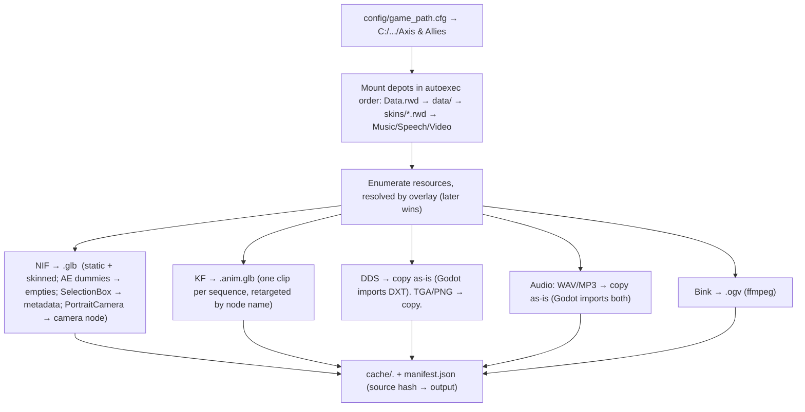

# Asset & Data Pipeline

How we reuse the original models, textures, animations, UI, audio and rules **without shipping them**.

---

## Legal model: Bring Your Own Data

* The repository contains **only our code and tools**. The game's files stay in the player's own install. A one-time **import step** converts them into `cache/` on the player's machine.
* `.gitignore` blocks `cache/`, `*.rwd *.nif *.kf *.dds *.tga *.bik`, and the local game-path config.
* Don't upload converted assets anywhere (GitHub, itch, Discord). If you ever release this, release the **engine only** and require an owned copy of the game, as OpenMW and OpenRA do. Use your own project name and logo. This isn't legal advice: "Axis & Allies" is a Hasbro trademark and the game content is copyrighted by its owners, so get proper advice before any public release.

---

## 1. Inventory of your install (scanned 2026-10-17)

| Kind | Count / size | Format | Notes |
|---|---|---|---|
| Archives | `Data.rwd` 644 MB / **13,428 files**, `Video.rwd` 216 MB / 42, `Video_En.rwd` 101 MB / 10, `Music.rwd` 57 MB / 34, `Speech.rwd` 19 MB / 100, `skins/{GBR,GER,JPN,RUS,USA}.rwd` ~11 MB / 220–233 each | **TGCK** archive (§2) | `tools/rwd.py list/extract/magic`, `sim/vfs/rwd_archive.cpp`. No duplicate names in any archive |
| Models | **1,900 `.nif`** (132.6 MB): 1,859 Gamebryo 10.1.0.0, 41 older NetImmerse 10.0.1 | Gamebryo | Verified: pyffi parses 10.1. Check the 41 old-format files in M2 |
| Animations | **581 `.kf`** (5.7 MB) + 1 `.kfm` (`Buildings/Campaign/HMSYork`, text) + 1 `.set` (`RUSConscript`) | 568 Gamebryo 10.1, 13 NetImmerse 10.0.1 (`JPNInfantryBanzai`, `HiResGBREngineer`, one `RUSConscript`) | Layout in §3 |
| Textures | **3,560 `.dds`** (218 MB, e.g. 256×256 **DXT5** with 9 mips), 2,269 `.tga` (63 MB), 2,133 `.png` (63 MB); skins add ~950 `.tga`/`.png` | | Godot reads DDS DXT1/3/5 |
| Rules/data | **1,842 `.tgi`** (5.6 MB), 10 `.lst` | Text, Windows-1252 (UTF-8+BOM for localization) | Parsed at runtime by the sim ([TGI_FORMAT](TGI_FORMAT.md)) |
| Video | 8 `.bik` in `Data.rwd` (main-menu globe and intros), 42 in `Video.rwd`, 10 in `Video_En.rwd` | Bink `BIKi` | Convert to `.ogv` (Theora) with ffmpeg |
| Audio | 1,007 `.wav` in `Data.rwd` (`Audio/Sounds/**`), 34 `.mp3` in `Music.rwd`, 100 `.mp3` in `Speech.rwd` | PCM WAV, MPEG-1 Layer III (§6) | Godot imports both natively: copy, don't convert |
| Maps | **80 `.rmp`** (18.2 MB) under `Maps/`, `Maps/Campaign`, `Maps/DeveloperMaps`, `Maps/TrailerMaps`, each next to a `.TGI` string table (58 have one) | chunked TGCK v2 container, zlib (§2.1) | Container is solved. Chunk contents are M10 |
| Other | 14 `.cur` + 1 `.ani` cursors, `Fonts/TrueType/A&A.ttf`, 3 `Shaders/*.vso` (D3D vertex shader bytecode), 2 stray `Thumbs.db` | | Not needed by the sim |
| Your mod | `data/` PER + SAU nations (units, regiments, buildings, trailers, templates, SAI, art), `tools/clone-nation.ps1`, `make-nation-art.ps1` | | Loads through the overlay VFS |

---

## 2. RWD archive format (TGCK)
Taken from your `tools/extract-rwd.ps1` (verified to work):

```
offset 0          : char[4] "TGCK"
offset EOF-128    : int32 dataOffset
offset EOF-32     : int32 tocOffset
TOC (from tocOffset until EOF-288, until an entry looks invalid):
   int32  fileType          (0 can appear mid-table, so it is NOT a terminator)
   int16  nameLength        (UTF-16 chars, 1..400)
   wchar  name[nameLength]  (UTF-16LE, relative path with \ or /)
   int64  offset            (+ dataOffset = absolute)
   int64  size
   int32  unknown
```
Files are stored **uncompressed**. Two readers implement this with the same TOC rules: `tools/rwd.py` (Python, for import and inspection) and `sim/vfs/rwd_archive.cpp` (runtime TGI reads through the VFS). Both port `tools/extract-rwd.ps1`. They produce identical bytes on spot-checked files and the same entry counts on all 10 archives.

* **Header detail** (`Data.rwd`, `Music.rwd`): `"TGCK"`, then int32 2, 3, 2, then a uint16-length UTF-16 archive name (`"AA"`) and 8 more bytes. Data starts at offset 30, which is the `dataOffset` in the footer.
* **TOC end:** the `.ps1` stopped when fewer than 31 bytes were left before `EOF-288`. That would silently drop a final entry with a 1-character name (an entry is at least 28 bytes). Both new readers loop while 28 bytes remain and bounds-check the whole entry. Real archives keep the same counts because they pad the TOC.
* **Overlay order** (`sim/vfs/vfs.cpp` `mountGameInstall`, per CLAUDE.md): `Data.rwd` → `data/` → `skins/*.rwd` (sorted) → `Music.rwd` → `Speech.rwd` → `%USERPROFILE%/Documents/Axis&Allies/data` → `Userdata/`. A later depot replaces the whole file at a path. Names compare case-insensitively with `/` separators. `Video*.rwd` isn't mounted because the sim never reads video. The importer reads those archives directly.

```bash
python -I tools/rwd.py list Data.rwd --summary          # counts and MB per extension
python -I tools/rwd.py list Data.rwd --long > cache/Data.rwd.toc.txt   # full TOC (gitignored)
python -I tools/rwd.py extract Data.rwd out/ --pattern '^Templates/'
python -I tools/rwd.py magic Data.rwd --pattern '\.rmp$'  # first 16 bytes of each file
python -I tools/rwd.py rmp "out/Maps/(2v2)Kursk.RMP" --out out/kursk   # map chunks, see §2.1
```

### 2.1 Map files (`.rmp`): chunked TGCK v2 container
Map files reuse the `TGCK` magic but have a different layout. All 80 maps parse with it:

```
offset 0  : char[4] "TGCK", int32 version = 2, int32 chunkCount (20 or 22), int32 0
offset 16 : chunk bodies, back to back (offset 12 holds the 4-byte "MAP" chunk)
EOF - chunkCount*96 : directory, one 96-byte record per chunk:
   wchar  name[32]         (UTF-16LE, NUL-padded)
   int64  offset           (absolute)
   int64  storedSize
   int64  stamp            (unknown; identical for every chunk of one map, not a FILETIME)
   int64  size             (uncompressed)
Bodies are zlib streams (78 9C); only "MAP" (4 zero bytes) is stored raw.
```

* **Chunks, in file order:** `MAP, MAP_HEADER, GWORLD, RULES, TERRAIN, HEIGHT_MAP, MOUNTAIN_HEIGHT_MAP, IDMGR, RESTRICTION_GROUPS, TEAMS, OBJECTIVES, KINGDOMS, [USED_REQUIRED_OBJECTS, USED_REQUIRED_OBJECTS_INDEX], DYNAMIC_THINGS, DYNAMIC_THINGS_INDEX, TRIGGERS, DENIZEN_GROUPS, SUN, UPDATABLES, MISC_DATA, MAPSTRINGS`. 68 maps have 22 chunks. 12 older ones lack the two `USED_REQUIRED_OBJECTS*` chunks.
* **Inside the chunks:** binary little-endian, with uint16-length-prefixed UTF-16 strings (`NORMAL`, `temperate…`, `team`, `kingdom`) and IEEE **float32** values (`HEIGHT_MAP` starts with −10.0, 10.0, 2.0). Each chunk starts with an int32 that looks like a per-chunk version. `TERRAIN`, `HEIGHT_MAP` and `DYNAMIC_THINGS` (placed objects, by IDS) are the large ones: Kursk unpacks to 546 KB, 253 KB and 744 KB.
* **`MAPSTRINGS`** is a `[Text language=Default]` TGI table, the same content as the loose `Maps/<name>.TGI`. In 8 of the 58 pairs the loose `.TGI` is **newer**: it fixes typos ("Afrika Korps", "Corps HQ") and reorders lines. **The loose `.TGI` overrides the embedded chunk.**
* **Determinism:** map data is float32. The M10 importer must convert it to `Fixed` with integer-only code (decode the IEEE bits), never through the FPU inside `sim/`.
* **Skirmish maps in the box:** 6 under `Maps/` (`(2v2)Berlin/Kursk/Market_Garden/Moscow`, `(3v3)Saint_lo/Stalingrad`). `(1v1)Golden Fields`, `(1v1)BorealForest`, `(1v1)MountianPass` and `(4v4)NorthernFrance`/`Sandstorm` are under `Maps/DeveloperMaps/`. There are 26 campaign maps and 14 trailer maps.

#### 2.1.1 Terrain layers (spike, decoded on all 80 maps)
`tools/rmp.py` decodes map size, both height layers, terrain type per tile, terrain class, blocking and (in TERRAIN v6) the settlement zones. It writes `map.json` and PNG previews (`height`, `mountain`, `surface`, `terrain`, `class`, `blocking`, `settlement`). `--survey` decodes every map in `Data.rwd`, and all 80 succeed. The format was worked out on `(1v1)Golden Fields` and checked on `(2v2)Kursk` and the campaign maps.

```bash
python -I tools/rmp.py "<game>/Data.rwd" "Maps/DeveloperMaps/(1v1)Golden Fields.RMP" --out cache/maps/golden_fields
python -I tools/rmp.py "<game>/Data.rwd" --survey
```

**Size and coordinates**
* A map has **N×N tiles** and **(N+1)×(N+1) height vertices**. N is 96, 128, 160, 192, 224 or 256; Golden Fields is 128.
* A tile is **2 m**, so Golden Fields is 256 m square and the biggest maps are 512 m.
* Vertex `(x, y)` sits at world `(2x, 2y)`. Every layer is row-major (`index = y·width + x`), and row 0 is world y = 0.
* Verified with placed objects: their stored positions (`DYNAMIC_THINGS`, e.g. town centres at (210, 74, 2.0) and (50, 200, 2.0)) lie on the interpolated height surface under this mapping, and not under the transposed one.

**`HEIGHT_MAP` and `MOUNTAIN_HEIGHT_MAP`** share one layout:
```
u32 version (1), f32 rangeMin (-10), f32 rangeMax (10), f32 default, u32 unknown (1), u32 count = (N+1)^2
f32 value[count]          row-major vertex grid
u8  vertexByte[count]     UNKNOWN: values 0..3 in HEIGHT_MAP (about 16% non-zero), all 0 in MOUNTAIN
(MOUNTAIN_HEIGHT_MAP has one extra trailing byte, 0)
```
* `HEIGHT_MAP`'s default is 2.0 (the ground plane, matching `SVars ElevationDefault = 2`). `MOUNTAIN_HEIGHT_MAP`'s default is 0.
* **Rendered ground = HEIGHT_MAP + MOUNTAIN_HEIGHT_MAP.** The mountain layer is positive under ridges and **negative under water**, so it carves lake and river beds. On Golden Fields the sum runs from −0.88 to 14.75. The objects tested sit where the mountain offset is 0, so the sum itself is inferred from the previews, not measured.
* The floats need an integer float32→Fixed conversion before the sim sees them (see Determinism above). Until the M10 importer does that from the raw bits, `tools/rmp.py` also writes integer millimetre copies (`vertex_height_mm`, `vertex_mountain_mm`) to `map.json`, and the sim's `loadRmpJson` (`sim/nav/map_def`) reads only those. Heights stay view-only.

**`TERRAIN`**
```
u32 version (6 or 7), u32 unknown (1), wstr biome ("chaparral", "temperate_forest", ...)
u32 nameCount, wstr name[nameCount]     terrain variation IDS table (245 in v6, 410/412 in v7)
u32 tileCount = N^2, u32 recordSize (6 for v6, 8 for v7)
v6 record: u16 word (low byte = name index, high byte = class), u16 flags, u16 orient
v7 record: u16 nameIndex, u16 orient, u16 flags, u16 class
...then an UNDECODED trailer (99 KB on Golden Fields, up to 363 KB): records with floats and
small ints, probably transitions / decals / blob data.
```
* **Terrain type:** `names[nameIndex]` is a TGI terrain **Variation** IDS (`chaparral_grass01`, `chaparral_mountain02`, `temperate_river01`…). Its parent `[Terrain]` (texture, colour, speed modifier) lives in `Terrain/<biome>/*.tgi`.
* **Class bits** (one byte per tile):
  * `0x10` = mountain (`MountainTerrain`, `type = MOUNTAIN`; the TGI notes the code forces its speed to 0.0001)
  * `0x20` = water (`WaterTerrain`, `water = true`)
  * `0x01` = map border, the outermost ring of tiles (and `0x21` where that ring is water)
  * `0x00` = ground
* **Blocking for land units = mountain | water | border.** Golden Fields has 4,129 blocked tiles of 16,384 (1,589 mountain, 2,276 water, 508 border). Bridges and fords show up as non-water tiles across rivers (Kursk), so they stay passable. This is terrain blocking only: placed objects (`DYNAMIC_THINGS`: forests, buildings, villages) block on top and aren't decoded yet.
* **Settlement zone (v6):** flags bit `0x04` marks the tiles around village/town centres. On Golden Fields, 96% of the 870 flagged tiles lie within 30 m of one of the two `chaparral_village_town_center` objects. This matches `template_object`'s `needs_space_for_settlement_zone`.
* **orient** (0–3) is most likely the texture rotation. That's an assumption: it isn't checked against the original renderer.

**Still unknown (stopped here, per the spike's scope):**
1. **v7 flags:** none of the bits 0x1/0x2/0x4/0x8/0x10 line up with city centres on Kursk (at most 19% within 30 m), so the v7 settlement flag is still unknown. The raw flags are kept in `map.json`.
2. The per-vertex byte after each height grid (0–3; maybe a smoothing or paint brush id).
3. The TERRAIN trailer.
4. The `u32 unknown = 1` fields.
5. The world-scale constant itself: 2 m per tile is measured from object positions, not read from a header field. `GWORLD` holds `f32 0.0625` (1/16, probably the 16 ticks/s game step), not a size.
6. Objects, kingdoms, triggers and the other chunks: out of scope for this spike (M10).

---

## 3. NIF / KF findings (spike results)

**Medium tank** (`PERTankMedium.NIF`): 20 `NiNode`, 11 `NiTriShape` (with normals and 1 UV set where textured), `NiTexturingProperty`/`NiSourceTexture` → `PERTankMediumBase.dds`, `Treds.dds`, plus `NiMaterialProperty`, `NiStencilProperty` (two-sided), `NiVertexColorProperty`, `NiZBufferProperty`, and extra data (`NiStringExtraData`, `NiIntegerExtraData`, `NiBinaryExtraData`).
Named nodes the engine uses: `Turret`, `Barrel`, `Chassis`, `Track Left`/`Track Right` (track UV scroll), `SelectionBox` (selection bounds, hidden), `PortraitCamera` (`NiCamera` for the unit portrait), plus attach points referenced by data (`exhaust_point_01`, `hitch`, `building_flag`, `spotlight_ae_01`, `window_01`, `door_01`, `Gun AE Dummy 01`). The **AE dummies are attach points for effects**, so keep them as glTF empty nodes.
**Z-up**, ~3.3 units long. Convert to Godot's Y-up at import (rotate the root −90° about X).

**Rifle infantry** (`PERInfantry.nif`): skinned. `NiSkinInstance` + `NiSkinData` + `NiSkinPartition` (7 partitions), **15 bones of a standard 3ds Max Biped** (`Bip01 Pelvis/Spine/Head/L-R Thigh/Calf/Foot/UpperArm/ForeArm/Hand`), with the full `Bip01` hierarchy (Clavicles, Neck, Toe0, `Bip01 NonAccum`), plus a `rifle` node and `Gun AE Dummy 01`. Equipment such as the rifle is shown or hidden via `FXC_Equipment` (`location = rhand`).
**Where the KFs live (TOC, 581 files):**
* **Shared biped animations: `Shared/Animations/Units/<Class>/<Clip>.kf`**, 152 files in 7 classes: `Infantry` (50), `InfantrySMG` (26), `InfantryMG` (16), `InfantryRPG`, `InfantryMortar`, `InfantryAT`, `Engineer` (15 each). The clip names are generic (`Walk`, `Jog`, `Idle`, `Fidget2`, `Die3`, `KneelAttack1`, `ProneAttack1`…). They're bound by root-relative paths in `Templates/template_aspect_animation_set_aa.tgi` and `template_charactercomponent_aa.tgi` (`kf = /Shared/Animations/Units/Infantry/KneelDie1.kf`). Every nation's infantry plays these on its own `Bip01` skeleton, so import them **once** as an AnimationLibrary retargeted by bone name.
* **Unit-specific KFs** sit next to their model as `<Model><Clip>.kf`: tank recoils, ambient animals (`Units/Ambient/Cow` 15, `Oxen` 10…), special infantry (`USAInfantryFlame` 14, `GERInfantryMG` 13, `RUSConscript` 9, `JPNInfantryBanzai` 8), battleships, `SpecialOps/Units/Saboteur` 11, and cutscene hi-res units.

**Animations** (`PERTankMediumRecoil1.kf`): `NiControllerSequence` + `NiTextKeyExtraData` (start/end and event markers) + 3× `NiKeyframeController`/`NiKeyframeData`. Map each sequence to a glTF animation clip named after the sequence, and turn text keys into **animation events** (e.g. footsteps, fire frame).

**Converter:** `tools/nif_gltf.py` (it grew out of the M1 spike) does NIF/KF → glTF. pyffi 2.2.3 needs two shims, both in the module: `time.clock` (removed in Python 3.8) and a stub `distutils.cmd` (removed in 3.12).

**Skinning facts (M2):**
* Many skinned NIFs are **saved posed**, not in their bind pose. The PER rifleman's bones differ from NiSkinData by up to 1.36 (rotation) and 0.45 m.
* The correct inverse bind matrix is `NiSkinData.bone_list[i].skin_transform` ("skin to bone"), applied to the shape's own vertices. Composing it with the overall `skin_transform`, or using `world(bone)⁻¹·world(shape)`, puts the mesh in the wrong place.
* Godot builds the Skeleton3D under `Bip01 NonAccum`. `Bip01` and `NonAccum` stay as plain nodes.

**KF facts (M2):**
* KF version 10.1.0.0 sequences have **no start/stop time** (that arrived in 10.1.0.106). The clip range comes from the `start`/`end` text keys, else from the controllers.
* The cycle type is in the controller flags (bits 1–2: loop/reverse/clamp). `Recoil1` is clamp, `Walk` is loop.
* **Root motion:** biped clips key `Bip01` (the accumulation root) to identity and move the hip height to `Bip01 NonAccum` (Walk: z 0.78). Models hold the height on `Bip01` (0.836) instead. Constant tracks must therefore be kept: if the identity `Bip01` keys are dropped, the soldier floats by about 0.8 m. Godot's `GLTFDocument.generate_scene` drops them by default; pass `remove_immutable_tracks = false`.
* XYZ-Euler rotation keys are composed X, then Y, then Z. Quadratic and TBC float/vector keys are evaluated as Hermite curves and resampled at 30 fps. Quaternion TBC keys are approximated with slerp.

---

## 4. Import pipeline (`tools/import_game.py`, M2)



**Run it** (Python 3.11+; pyffi is the only package. numpy and pygltflib were dropped because PyPI downloads here ran at about 800 B/s):

```bash
python -m venv .venv && .venv/Scripts/python -m pip install -r tools/requirements.txt
.venv/Scripts/python -I tools/import_game.py                   # whole install -> cache/
.venv/Scripts/python -I tools/import_game.py --only '^Units/PER/'  # a subset
```

**What it produces** (`tools/import_game.py`, `tools/nif_gltf.py`, `tools/gamevfs.py`):

| Input | Output | Notes |
|---|---|---|
| `X.nif` | `X.glb` | Node hierarchy, NiTriShape **and NiTriStrips** (strips → triangles), normals, UV0, vertex colours (unless NiVertexColorProperty ignores them), skins (4 strongest weights, NiSkinPartition fallback), PortraitCamera → glTF camera, embedded NiKeyframeController animation → clip `embedded`. Node extras: `nif_type`, `hidden`, `selection_box` (local AABB) |
| `X.kf` | `X.anim.glb` | One glTF animation per NiControllerSequence. One flat node per target name, so clips retarget **by node/bone name**, as in Gamebryo. Extras: `duration`, `cycle_type`, `frequency`, `text_keys` |
| `*.dds/.tga/.png` | copied as is | Godot's `GLTFDocument` resolves `.dds` URIs at runtime, and `Image.load_dds_from_buffer` keeps DXT plus mipmaps. No conversion needed |
| NiPixelData (embedded) | `X.embeddedN.dds` | Via pyffi `save_as_dds` (42 models) |
| — | `manifest.json` | Per source: depot + offset/mtime + size + converter version, the outputs, warnings and skipped blocks. Plus model/clip/texture lists and `compatible_clips` |

* **Materials:** NiTexturingProperty base map, NiMaterialProperty diffuse/alpha/emissive, NiAlphaProperty (bit 9 alpha test → `MASK` with cutoff = threshold/255, else bit 0 → `BLEND`), NiStencilProperty draw mode 3 → double-sided.
* **Texture lookup:** a NIF names only the file (`PERTankMediumBase.dds`). The importer tries it relative to the NIF, then from the root (for `/` paths), then the same file name anywhere, choosing the folder that shares the longest prefix with the NIF. That last step is how the game's TextureSearchPath sharing behaves. In the full run 1,231 references resolved by name; the 10 left unresolved name files that aren't in the install at all (`SavannahRocksBase.dds` ×5, `JPNBunkerGround.dds` ×2, …).
* **Incremental:** unchanged sources with the same converter version (`nif_gltf.CONVERTER_VERSION`) are skipped. A full import of this install takes about 17 minutes on 3 worker processes (2,771 NIF/KF files, 8,880 textures, about 240 MB of glTF). Re-runs take seconds.
* **Clip compatibility:** a clip drives a model if at least 90% of its targets are named in the model, and it lives in the model's folder or under `Shared/Animations/`. All 112 biped unit models get the shared infantry clips.
* **Not converted (logged per file):** particle systems (754 NiParticleSystem and older NiParticles: these are VFX we rebuild in Godot), NiLookAtController/NiPathController (56/55), lights, NiVisController. Also **9 NetImmerse 4.2.2.0 files** (`Doodads/Shared/Waves/*`, `TanksDead/TankDead`, 4 effects, `ThingAreaMarker`): pyffi 2.2.3 can't read their embedded NiPixelData. They're not units or buildings.
* **Determinism:** none of this touches `sim/`. Models, clips and textures are view-only.

* **Naming:** keep the original relative paths (`Units/PER/PERTankMedium/PERTankMedium.glb`) so the TGI fields `resource_prefix`, `kf`, `icon`, `banner_icon`, `TextureSearchPath` resolve with no remapping table.
* **resource_prefix rules** (from data): `resource_prefix = PERTankMedium/PERTankMedium` inside `Units/PER/...` means `<prefix>.nif` is the live model, `<prefix>Death.nif` is the death model, `<prefix>Base.dds` the texture, `<prefix>Icon.tga` the HUD icon, and `<prefix>Pack/Unpack.nif` the building transition models. Paths starting with `/` are root-relative. `TextureSearchPath` adds folders to the texture lookup (e.g. buildings borrowing tank textures).
* **Biome variants:** `Arctic/` and `Desert/` subfolders hold alternative textures. Material swap at runtime by map biome.
* **Nation colours:** handled by your `clone-nation.ps1` DXT recolour for mods. At runtime, team colour comes from `kingdom_colors.tgi` (flags, banners, decals).
* **Model Browser** (`godot/scenes/tools/model_browser.tscn`, built in M2):

  ```bash
  godot --path godot res://scenes/tools/model_browser.tscn
  ```

  * **Lists** every model in `cache/manifest.json`, with a text filter and a top-folder category.
  * **Loads** the chosen model at runtime with `GLTFDocument`, so there's no editor import of thousands of files.
  * **Clips:** plays the model's own embedded animation and every compatible clip, retargeted by name (`godot/scripts/tools/cache_loader.gd`).
  * **Overlays:** draws attach points (AE dummies, exhaust/light/flag points…) as labelled axes, and the SelectionBox AABB as a wire box.
  * **Biome switch:** swaps textures for their `Arctic/` and `Desert/` variants.
  * **Options:** `-- --cache=DIR`, `--model=REL`, `--clip=TEXT`, `--biome=Arctic`, `--screenshot=PNG` (for automated checks).
  * **Headless check:** `godot --headless --path godot --script res://tests/test_cache_loader.gd`.
  * **Rendering:** on this laptop's Intel HD 3000, Godot falls back to the Compatibility renderer (ANGLE). The browser works there.

---

## 5. Runtime data (TGI) is **not** converted
The sim reads TGI straight from the depots at startup (fast: a few MB of text). That keeps mods hot-swappable and avoids a stale-data class of bugs. `simcli dump-defs --json` exports the resolved definitions for inspection and for the AI tools.

---

## 6. Open questions to resolve in M1/M2

| Question | How to answer |
|---|---|
| ~~Map file extension and format inside `Data.rwd`~~ | **Answered (M1):** `.rmp`, a chunked TGCK v2 container with 20–22 named zlib chunks (§2.1). **Terrain layers decoded (M10 spike, §2.1.1):** size, heights, terrain types, class and blocking. Objects and the remaining chunks are M10 work |
| ~~Where the shared biped KFs live~~ | **Answered (M1):** `Shared/Animations/Units/<Class>/*.kf` (152 files, 7 classes), bound from the animation-set templates. Unit-specific clips sit next to their models. See §3 |
| ~~Audio container~~ | **Answered (M1):** `Data.rwd` has 1,007 RIFF WAV, PCM 16-bit **mono 22,050 Hz** (3 at 44.1 kHz under `Audio/Default/`). `Music.rwd` has 34 MP3, MPEG-1 Layer III 128 kbps 44.1 kHz joint stereo, no ID3. `Speech.rwd` has 100 MP3, 128 kbps 44.1 kHz **mono**, 99 with ID3 tags. No proprietary container; copy as is. Archive paths are `Audio/Sounds/…`, `Audio/Music/…`, `Audio/Speech/…`. TGI `files =` values are relative to the record's file (`Audio/*.tgi`, see TGI_FORMAT §9.3) |
| Terrain textures and transitions | `Terrain/**` in TOC (`index_aa.lst` loads `Terrain/<biome>/*.tgi`) |
| Effects (VFX) definitions | `Effects/*.tgi`, `template_vfx_aa.tgi`. Likely particle params we reimplement in Godot GPUParticles3D |
| Fonts | `Fonts/*.tgi` + bitmaps. The TOC also has `Fonts/TrueType/A&A.ttf`, so check whether that's the UI face before replacing it |
