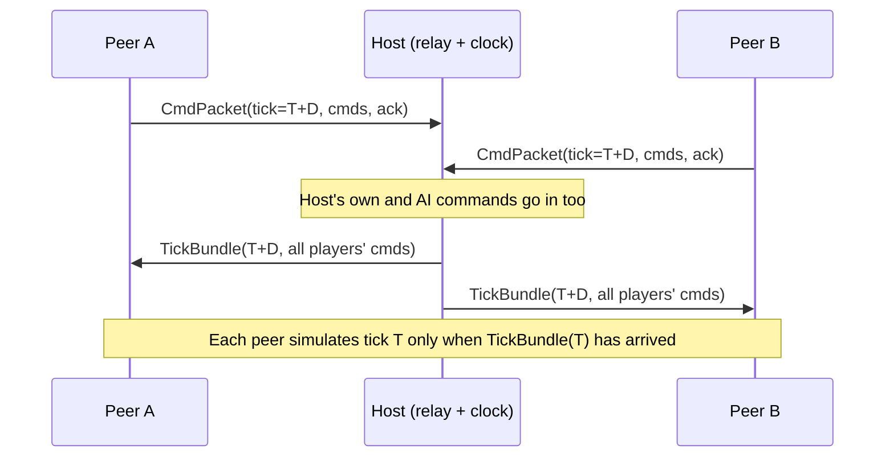

# Netcode Design: Deterministic Lockstep

---

## 1. Model choice

| Option | Bandwidth with ~1,300 units | Fits the original? | Verdict |
|---|---|---|---|
| **Deterministic lockstep** (send commands only) | Tiny (~1–5 kbit/s per player) | Yes. The original used fixed-point and saved command-stream films (`.RFM`) | **Chosen** |
| State replication / client-server snapshots | Large (positions of every unit) | No | Rejected |
| Rollback | Needs fast re-simulation of the full RTS state | Overkill | Rejected |

Lockstep gives us **multiplayer, replays, save validation and AI-in-the-loop with one mechanism**. The price is strict sim determinism (enforced in [ARCHITECTURE.md §6](ARCHITECTURE.md#6-cross-cutting-rules-also-in-claudemd)).

---

## 2. Timing

| Parameter | Value |
|---|---|
| Sim tick | **10 Hz** (100 ms) |
| Command input delay `D` | Adaptive, **2–8 ticks** (200–800 ms), default 3 |
| Hash exchange | Every 10 ticks (1 s), always on |
| Render | Decoupled, interpolated (60+ fps) |

A command issued during local tick `t` is scheduled for **tick `t + D`**. The local UI gives **instant feedback** (acknowledgement voice, move marker, ghost formation), so the delay isn't felt.

**Adaptive D:** the host measures RTT and jitter for every peer, and sets `D = ceil((maxRTT/2 + 2×jitter + processing) / tickLen) + 1`, clamped to 2–8. Changes are announced as a command (`SetInputDelay`, effective at a future tick) so every peer switches on the same tick.

---

## 3. Topology: host-relayed star



* **Why a star, not full P2P:** only the host needs reachable ports (or a relay later), there's one ordering authority (no consensus problem), and it's simpler. The host has **no simulation authority**. It only orders commands and sets the clock, and it runs the same deterministic sim as everyone else.
* **Empty ticks:** each peer sends a (possibly empty) `CmdPacket` for every tick it wants to advance. That doubles as a heartbeat. The host sends `TickBundle(T)` once it has every peer's packet for T, or after a **timeout** (see §6).
* **AI players** live on the host ([AI.md](AI.md)). Their commands are added to the host's queue.
* **Later (optional):** a tiny dedicated **relay server** (same protocol) for NAT traversal and to avoid host advantage. Steam networking can replace ENet with no protocol change.

---

## 4. Transport & packets

* **ENet** through Godot's low-level `ENetConnection` (not the high-level RPC system). Channels:
  * ch0, reliable ordered: `CmdPacket`, `TickBundle`, control (lobby, pause, speed, surrender, D changes)
  * ch1, unreliable: ping/pong, cursor and camera hints for observers
  * ch2, reliable: chat, flares (also sent as sim commands if they must appear in replays)
* Ports: configurable, default **6900/UDP** (mirrors the original for nostalgia; not required).

**Command encoding** (little-endian, varints):
```
CmdPacket  { u32 tick; u16 seq; u8 count; Command[count] }
Command    { u8 type; u8 player; varint payload... }   // EntityIds as varint index+gen
TickBundle { u32 tick; u8 nPlayers; (u8 player, u8 count, Command[count])* ; u32 hostHashTick; u64 hostHash? }
```
Typical command: 6–20 bytes. Selections of up to 6 regiments go in **one command** (`MoveGroup{ids[], goal, facing, formation}`).

**Command set** (initial): `MoveGroup, AttackTarget, AttackMove, Run, Stop, Guard, SetFormation, SetGroupBehaviour, Pack, Unpack(pos, rot), Deploy(buildingId, orgType), CancelDeploy, Research(buildingId, item), Build(engineerReg, structType, pos, rot), Repair, UseSpecialOp(opId, target), Tribute, Flare, Surrender, SetInputDelay, Pause, SetSpeed`.

**Validation** happens **inside the sim** when a command is applied (ownership, affordability, placement legality). An invalid command is ignored deterministically on every machine and also flagged to the issuing player's UI. A cheating client can't do anything a legal command couldn't.

---

## 5. Determinism checking & desync tooling

* After tick T (every 10 ticks), each peer computes `hash = xxh3_64(canonical sim state)` and sends `(T, hash)` to the host on ch0.
* The canonical state is serialized in a fixed order: entity pools by ascending id, components in a fixed field order, all RNG states, kingdom state, and the sim's own pending queues (pathfinding included). **Command bundles for future ticks are not state.** They sit in the session's CommandQueue, peers receive them at different times, and `Sim::step` takes exactly one tick's commands. Implemented in `sim/session/state_io` (format v1).
* **Hash mismatch:**
  1. The host broadcasts `DesyncDetected(T)`.
  2. Every peer writes `desync_<player>_<T>.state` (full canonical dump) plus the replay so far.
  3. The game ends with a "Desync, report sent" message (no resync in v1).
  4. `simcli diff a.state b.state` prints the first differing entity and field. `simcli bisect replay.rpl` re-runs the replay with per-system hashing to find the **first divergent tick and system**.
* **Debug builds** hash **every tick and every system**, which makes catching determinism bugs during development almost automatic.
* **CI:** play 20 recorded replays on Windows/MSVC and Linux/Clang (Debug and Release) and assert identical final hashes.

---

## 6. Lag, stalls, disconnects

* **Stall:** if `TickBundle(T)` hasn't arrived when the local clock wants tick T, the peer **waits** (the sim freezes, rendering continues with UI and camera responsive). After 3 s show "Waiting for <player>…". After a configurable 60 s timeout the host offers **Drop player**.
* **Time sync:** the host is the clock. Peers that fall behind (more than 2 bundles queued) run **catch-up ticks** (up to 2 sim ticks per frame) until caught up.
* **Slow-machine fairness:** the host can lower game speed for everyone (a `SetSpeed` command). The original also slowed down for the slowest player.
* **Disconnect / drop:** the host emits `PlayerLeft(player, tick)` in a TickBundle, and from that tick the player's kingdom is controlled by an **AIController** on the host (or surrendered, per lobby option). Deterministic for everyone.
* **Host leaves:** v1 ends the game for everyone, with the replay saved. Host migration is a stretch goal (needs state-hash agreement plus a bundle handover).
* **Reconnect / join in progress (stretch, M9+):** the host sends a **compressed snapshot** at tick S plus bundles S…now, and the joiner fast-forwards. That needs save/load parity, which we build anyway.

---

## 7. Lobby & compatibility

Before launch, every peer reports:
* `simVersion` (git hash of `sim/`), `protocolVersion`
* **`dataHash`**: hash of the compiled defs from TGI (so a peer with the PER/SAU mod and one without can't play together accidentally)
* Asset cache version (cosmetic only; mismatch = warning, not a block)

Then the lobby (host-authoritative state, reliable channel) collects: map/RMC plus seed, settings (fog, start money, start XP, city ratio, speed), players (nation, general, team, color, AI personality), and the **match seed** (host-generated, sent to all). Game start = everyone confirms the same `MatchConfig` hash.

---

## 8. Replays ("Films") & saves

```
Replay file (.rpl; v1 is uncompressed with a trailing xxh3 integrity hash, zstd later)
  Header  { magic, simVersion, protocolVersion, dataHash, MatchConfig, seed, playerNames }
  Stream  { TickBundle* }             // exactly what the host broadcast
  Hashes  { (tick, hash)* every 10 ticks }   // used to verify playback
```
* Recording is **always on** (`LastFilm.rpl` overwritten each game, like the original's `LAST FILM.RFM`).
* Playback = run the sim with the bundles. Seek = re-simulate from the start, or from periodic **keyframe snapshots** stored every 60 s in the replay for fast seeking.
* A replay from another `simVersion` shows "incompatible version" (optional: keep old sim builds as plugins later).
* **Save games** = full canonical state snapshot plus the replay so far (for debugging). Loading must reproduce the same hash. That's a CI test.

---

## 9. Security notes (casual-competitive level)

* Lockstep exposes full state to every client, so **maphacks are possible**. Accept that for v1 (same as the original and most lockstep RTS games).
* Speed hacks are impossible (host clock). Illegal commands are rejected by sim validation.
* Rate-limit commands per player per tick (e.g. 32) to stop flooding.

---

## 10. Bandwidth estimate
8 players × 10 ticks/s × ~8 bytes (empty packet plus header) ≈ **0.7 KB/s upstream to the host** at idle. During heavy micro (5 commands/s/player × 16 B) it's < 2 KB/s total. The host's downstream to each peer is about the same. A 2004 modem could carry it, so a 2026 connection has no trouble.
