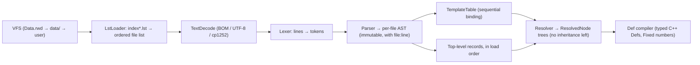

# TGI format, loader and template resolver (M1 design)

How the original game's rules text (`*.tgi`, `*.lst`) is read, ordered, and resolved into
inheritance-free node trees. That output is what the def compiler (`UnitDef`, `RegimentDef`...) turns into typed sim
structs. Implemented in M1 (`sim/vfs`, `sim/data/tgi`, `simcli`). On the real install the C++ loader reproduces
the prototype's numbers below, and §7.4, §8 and §10 now carry counts measured with it.

Related: [ARCHITECTURE §4.1–4.2](ARCHITECTURE.md#41-vfs--depots-simvfs-also-used-by-the-view),
[ASSET_PIPELINE](ASSET_PIPELINE.md), [MILESTONES M1](MILESTONES.md).

---

## 0. Evidence base and decisions at a glance

Every rule below was checked against the real data, not inferred from a sample. On 2026-10-17 I listed the
`Data.rwd` TOC (13,428 entries), extracted its 1,866 text files to a scratch folder, and ran survey scripts over all
**2,062 `.tgi` files** (1,842 from `Data.rwd` + 220 from `data/`). One of those scripts was a prototype loader that
replays `index_aa.lst` over the overlay and reached **1,860 files in load order** (219 of them from `data/`). The
scripts were throwaway and are not in the repo. Counts quoted below come from that run.

| Topic | Decision | Evidence (short) |
|---|---|---|
| Encoding | BOM → UTF-8; else valid UTF-8 → UTF-8; else Windows-1252 | 1,848 ASCII, 118 cp1252, 96 UTF-8+BOM; your PowerShell tools write UTF-8 without BOM |
| Comments | `;` and `//` to end of line, `/* */` **non-nesting**, all quote-aware | `translate.tgi` comments out lines 1292–5310 with three `/*` and one `*/` |
| Structure | Line-oriented. Header lines `[...]`. Braced `{}` or **braceless** bodies | 36,297 fields sit in braceless bodies |
| Template table | One global, case-insensitive namespace, **bound in load order** (latest definition already loaded) | 0 forward references in 1,860 files. 2 redefinitions, both correct under this rule |
| Scalars | Later layer replaces | — |
| `[list X]` children | **Append**: inherited items first, then local | 527 Things add to inherited `[Property]` lists, and the effects/FX are clearly meant to stack |
| Named (non-list) child, no `template=` | **Deep merge** into the inherited child | `[BodyComponent] health=…` etc. |
| Named child **with** `template=` over an inherited one | **Rebase**: drop the inherited child, start from the new template | 124 cases. Only 8 Things differ from "merge", and merge would duplicate FX lists |
| Top-level identity | Def compiler decides per type: by IDS (last wins), singleton-merge, or ordered records | `SVars.tgi` → `SVars_AA.tgi` override 36 vars. `Translate` is 182 records |
| Numbers | Parsed to `Fixed` Q32.32 / `int64` with integer-only code in `sim/data` | `1.0f`, `.5`, `25%`, `+2` all occur in sim-relevant files |
| Errors | Lenient like the original, but every recovery is logged with file:line | Missing `]`, missing `}` at EOF, stray `=`… (§10) |

---

## 1. Pipeline



The stages run strictly in order, once, at startup. They're pure functions of the bytes in the depots, so the
output is deterministic and can be hashed (`data hash`, ARCHITECTURE §4.2).

---

## 2. Files and text decoding

* **Decode order:**
  1. A UTF-8 BOM `EF BB BF` means UTF-8. Strip it. The 96 such files are under `Localization/` and `Namelists/`.
  2. Otherwise, if the bytes are valid UTF-8, decode as UTF-8 (ASCII is a subset).
  3. Otherwise decode as **Windows-1252**. The 118 cp1252 files mostly carry `©` (0xA9). A few have smart quotes
     0x93/0x94 and `é`.
* Files rewritten by `tools/install-index.ps1` and `clone-nation.ps1` are UTF-8 without BOM. `data/index_aa.lst` has a
  `U+FFFD` where `©` used to be, but only inside comments. No `data/` value is damaged. Future tools should copy bytes
  or write cp1252.
* Line endings are all CRLF in the corpus. Accept CRLF, LF and lone CR.
* After decoding, everything is held as UTF-8 `std::string`. Identifiers (types, keys, template names, IDS) compare
  **ASCII case-insensitively**. Never use locale functions (no `tolower` from `<cctype>` with a locale, no `std::locale`).

---

## 3. Lexical rules (line-oriented)

The engine is line-based, and the parser should be too. A file goes through comment stripping, then
line classification, then block building.

### 3.1 Comments
| Form | Rule | Notes |
|---|---|---|
| `;` and `;;` | to end of line | Also after headers and values: `[Slot]	;; front`, `icon = null ;; %sIcon.tga` |
| `//` | to end of line | Rare: one real use, `template_sai.tgi:287`. Never inside quotes, so URLs in strings are safe |
| `/* … */` | **non-nesting**, may span lines | `template_rmc_*_aa.tgi` headers miss their closing `/` and are closed by the next `/*…*/`. Under nesting rules, 7 files would never close |
| quotes | `"` toggles "in string" for the rest of the **line**. Comment markers inside strings are text | `strings_data_AA.tgi` has `;` inside subtitles. `actor_commands.tgi` has `"#…" ;"old text"`. Strings never span lines |

An unterminated `/*` runs to EOF and produces a warning. The whole-file test for this is `translate.tgi`.

### 3.2 Line classes (after stripping, trimmed)
1. **blank**: ignore.
2. **header**: first character is `[`.
3. **brace line**: starts with `{` or `}`. `{}` on one line is an empty body (`template_sai.tgi:1738`). Text after
   `{` is read as the first line of the body. 3 files do this: `{	resource_prefix = …` in `rus_infantry_co.tgi`,
   `usa_infantry.tgi` and `usa_infantry_marine.tgi`. Text after `}` (comments excepted) is re-read as a line of its
   own, with a warning (`text-after-brace`, none in the corpus). Text after a header's `]` is handled the same way
   (`header-trailing-text`, none in the corpus).
4. **field line**: anything else.

### 3.3 Header lines
```
header     = "[" { word | attr } [ "]" ] trailing ;
attr       = key ws* "=" ws* value ;          (* spaces around '=' allowed: 1,533 headers have them *)
modifiers  = "list" | "optional" | "optional" "list" ;
```
* **Missing `]`** is tolerated: the header ends at end of line. There are 3 cases: `template_ability_special_op_aa.tgi:215,220`
  and `mg_territories.tgi:3290`.
* Attribute keys are case-insensitive. **`template=` and `inherit=` are synonyms everywhere**, including nested nodes
  (`[WhenDo Inherit=AAFXCTankShot01]`). Counts: `Template` 22,290, `template` 3,341, `Inherit` 1,311, `inherit` 109.
  The other attribute in use is `language=` on `[Text]` blocks (153 uses). If a header has both `template=` and `inherit=`, use `template=` and warn.
  The corpus has none.
* A **stray `=` token** is dropped with a warning: `[DenizenType = Template=DenizenType]` (`Game/denizen_types.tgi`).
* Header shapes, by word count once attrs are removed:

| Shape | Meaning | Example (synthetic) |
|---|---|---|
| `[Template Name attrs]` | template definition. Top level only (0 nested in corpus) | `[Template FooUnit inherit=Unit]` |
| `[list Name attrs]`, `[optional Name attrs]`, `[optional list Name attrs]` | **schema declaration** of a child. Appears only inside templates | `[list Turret Template=Turret]` |
| `[Name attrs]` | data node (instance, component, list item…) | `[BodyComponent]`, `[Thing Template=FooUnit]` |

### 3.4 Field lines
Split at the **first `=` that's outside quotes**.

* **Key side** (left of `=`, trimmed):
  * 2 tokens whose first is a **type word** → typed field. Type words are case-insensitive:
    `string localized flag bool fixed int float point2 point3 KF32 FXC`. Counts: fixed 935, string 814, int 341,
    flag 333, float 269, localized 194, bool 143, point3 131 (11 spelled `Point3`), point2 66, KF32 3, FXC 1.
  * Anything else is the key, **literal, spaces included**. Localization has `mg_territories_Aleutian Islands_name`,
    `key_[`, `key_]` and `ui_update_download failed|s`.
  * Keys may contain `|`. Game events use `game_message|*`. Localization uses `…|sd` / `…|fff`, which look like printf
    argument signatures. The resolver keeps the key verbatim. What `|*` means is a view concern (§12).
* **Value side**: the raw rest of the line, trimmed. See §9 for typing.
* **No `=`:**
  * `type name` declares a field with no default (`point2 location`, `KF32 time`).
  * A single token `name` is a **bare key**: the field is declared, has no value, and is required. In a derived
    template it also *clears* the inherited value. Examples: `texture` under a "REQUIRED FIELDS" comment in
    `scorch_marks.tgi:21`, `amount` in `template_terrain.tgi:162`, `num_goals` in `template_sai.tgi`.
  * Any other line is a warning (`unparsed-line`). There were none outside the cases above.

### 3.5 Quoted values
If the value **starts and ends** with `"`, remove exactly that outer pair. Inner quotes are kept literally:
`text = "@Billy "BMC" McCain"` in `credits.tgi`. Strings have no escape processing. `\n` and `%s` stay as text, and the
text renderer and formatter handle them later. One edge case is `"#…_help_string""` with a doubled closing quote
(`Game/trigger_elements.tgi`). It leaves a trailing `"` after stripping. For `#` localization refs, trailing `"` is
trimmed with a warning.

---

## 4. Grammar

```ebnf
file        = { blank | header_block | stray_close } EOF ;
header_block= header body ;
body        = braced | braceless ;
braced      = "{" { field | header_block | blank } "}"        (* '}' may be missing at EOF *)
            | "{}" ;
braceless   = { field | blank } [ late_open ] ;                (* ends at next header or '}' *)
late_open   = "{" { field | header_block | blank } "}" ;       (* see §5, usa_carrier [Size] *)
field       = typed_key "=" value | key "=" value | type_word name | name ;
stray_close = "}" ;                                            (* at root: ignored with a warning *)
```

---

## 5. Block structure

* **Braced:** the header is followed (after any blank or comment lines) by a line starting with `{`. The body runs to the
  matching `}` and can contain fields and child headers.
* **Braceless:** a header with no `{`. Its body is **all following field lines up to the next header line or `}`**. So a
  braceless node can only have fields, never child nodes, and any field written after it belongs to it. This is the
  most common shape in unit data: `[Property]` / `property_IDS = front`, and `[WhenDo …]` / `audio_ids = …`. Indentation
  is ignored. I checked the 25 places where a braceless field is indented *less* than its header. All of them still
  belong to the braceless node (for example `[Upkeep]` then `building_limit_consumed = 0` in `*_truck_supply.tgi`).
* **Late `{`:** a `{` that arrives while a braceless node is open turns it into a braced node. The fields read so far
  stay with it. The one case is `Units/USA/usa_carrier.tgi:120–134`: `[Size]`, two fields, then `{ …blocking_shape… }`.
  The brace count only balances under this reading.
* **Unclosed at EOF:** close every open node and warn. There are 6 files: `Units/{JPN,USA}/*_truck_armor.tgi`,
  `Buildings/Campaign/normandy_beach_bunker_artillery0{1,2,3}.tgi` and `nafrica_villageblock14x35_02.tgi`.
* **Extra `}` at root:** ignore and warn.
* **`{` with no open header (anonymous block):** warn, then parse it as a nameless node and drop it. The corpus has none.

### 5.1 AST (per file, immutable)
```text
AstFile   { fileId, path, nodes: [AstNode] }                     // top-level, in file order
AstNode   { kind: Template | Decl | Data,
            name,                       // node type ("Thing", "BodyComponent") or template name
            mods: {list?, optional?},   // Decl only
            parentRef?: string,         // from template= / inherit=
            attrs: [(key, value)],      // other attrs, e.g. language=
            fields: [AstField], children: [AstNode],             // both in source order
            braced: bool, loc }
AstField  { key, declType?, value? (raw text), loc }             // value absent → bare/declared-only
loc       { fileId, line }
```
Order is preserved everywhere. Nothing in the AST is a hash container.

---

## 6. Load order (`LstLoader`)

### 6.1 Depots
The mount order comes from `startup/autoexec.txt`. For TGI the relevant part is `Data.rwd` → `data/` → user overlay
(`%USERDATA%/data`, `Userdata/`). The `EngineData/` depots in autoexec aren't present in this install. Each depot maps
`lower-case path → file`, and a **later depot replaces the whole file** at that path. File contents never merge. This
is how the PER/SAU mod works: `data/index_aa.lst` and `data/templates_AA.lst` replace the archive copies and add the
PER/SAU lines. Paths normalise `\` to `/` and compare case-insensitively (`templates.lst` writes `Templates/…`,
`templates_AA.lst` writes `templates/…`).

### 6.2 Algorithm
```text
roots = all VFS root entries matching "index*.lst", sorted (§6.3)      // today: only index_aa.lst
for each root: processList(root)

processList(lst):
  guard against recursion (a list already on the stack → error, skip)
  for each line: drop ';' comment, trim, skip blank
    matches = expand(spec)                                            // §6.3
    if no match: wildcard → silent;  explicit path → warning "missing file"
    for m in matches:
      if m ends with ".lst": processList(m)                           // nested list is processed in place
      elif m already loaded: warning "duplicate", skip                 // none in current data
      else append m to loadOrder
```
* Wildcards are `*` in the **last path component only**. They're not recursive (`Terrain/*.tgi` and
  `Terrain/Transitions/…` are separate lines) and match case-insensitively. The match set is the **union across all
  depots**, with each path counted once.
* **14 specs match nothing** in this install and must be silent, for example `Units/*.tgi`, `Regiments/*.tgi`,
  `RandomMap_OLD/*.tgi` and `Cutscene/Scene/*.tgi`.
* `.lst` files nest: `index_aa.lst` → `templates.lst`, `templates_aa.lst`, `mg_resources.lst`.
* Files that are never listed are **never parsed**. Lazy parsing isn't enough here, because unlisted files can be
  broken. `Buildings/Villages/EasternEurope/EasternEuropeCityCenter02/*.tgi` references 3 templates that exist nowhere.
  `AVars*.tgi` and `UVars*.tgi` at the root are application vars the engine loads outside the index, so they're out of
  M1 scope except for documentation. `Maps/**/*.TGI` are per-map string tables (M10). UI files load through
  `UI/*.lst` (presentation layer, not the sim).

### 6.3 Sort order inside a wildcard
The archive TOC is **not** sorted (only 541 of 1,686 directories happen to be in order), so the engine has to sort.
We sort by **ordinal comparison of the upper-cased path**, which is what NTFS directory enumeration returns on
Windows. Upper-case versus lower-case folding gives a different order in 12 loaded directories (for example
`per_car_armored_co.tgi` against `per_carrier.tgi`). I checked both orders: neither has a forward template reference
or a cross-file IDS clash, so the difference isn't observable in today's data. It's still listed as open in §12,
because mods could make it matter.

---

## 7. Templates and resolution

### 7.1 Template table: global, sequential binding
* `[Template Name parent?]` registers `Name` (case-insensitive) when the parser reaches it in load order.
* Any reference (`template=` / `inherit=` on a template, a data node or a nested node) **binds to the most recent
  definition already loaded**, earlier in the same file or in an earlier file. The binding is fixed at that moment:
  a later redefinition of a parent doesn't change templates that were already bound to it.
* Evidence:
  * There are **0 forward references** across all 1,860 files, so authors always defined templates before using them.
  * `regiment_rus_paratrooper.tgi` and `regiment_rus_paratrooper_heavy.tgi` **both** define `AARUSRegimentParatrooper`
    and each instantiates it right away. Sequential binding gives each file its own version. "Global last wins" would
    give normal paratroopers the heavy loadout.
  * The other redefinition, `AAUSAAttackBattleShipBombard` in `Cutscene/Units/…`, comes after every real user.
* Each redefinition produces a warning (`template-redefined`). An unknown parent is an error diagnostic: the node
  resolves with an empty base, and its def is dropped from compilation if the def compiler can't build it.
* **About the MG note in `tools/install-index.ps1`**, which says division/army templates "are only visible inside the
  same file": that's **not** a general rule. 157 templates defined outside `Templates/` are used from other files
  (`Game/resource_list.tgi`'s `CostList` is used by every building). M1 will re-test it with the real loader. If the
  metagame really does scope templates per file, it becomes a flag on `mg_resources.lst` processing, not a change
  to the core rule.

### 7.2 Schema: what templates declare
Templates mix **schema** (field types, defaults, child declarations) with **values**. The resolver carries both.

| Template line | Effect on the resolved node |
|---|---|
| `type name = v` | declare `name: type`, value `v` |
| `type name` | declare `name: type`. The value is unchanged (inherited, or unset) |
| `name = v` (untyped) | set the value. Declare as untyped if new (`recruitable = NO` in `Actor`, which no parent declares) |
| `name` (bare) | declare as required and **clear** any inherited value |
| `[list X template=T] {…}` or braceless | child X is a **list**. Its items default to template T. A body is an inline item schema (`[list Biome] { string IDS … }`) |
| `[optional X template=T]` | child X is **absent until used**. When a node `[X]` appears, it starts from T |
| `[optional list X …]` | optional list (3 uses) |
| `[X template=T]` / `[X] {…}` (no modifier) | child X is **present** (materialised), starting from T or empty |

Typed lines can also appear in non-template nodes: `[SVars]`, `[Nation]`, and `fixed weight = 1.0` (65 times under `Buildings/`).
They mean "assign, and declare if new". A type change on redeclaration is a warning (`type-redeclared`), except
between `bool` and `flag`, which parse the same way. `SVars_AA.tgi` redeclares `UnitSupplyEnabled` as `flag` over
`SVars.tgi`'s `bool`. Apart from that, the corpus has no type changes.

### 7.3 Base template for a node
The first of these that exists wins:
1. Explicit `template=` / `inherit=` on the node.
2. The child declaration in the parent's resolved schema (`[list Turret Template=Turret]` makes a `[Turret]` item
   start from `Turret`).
3. **Top-level only:** a template with the same name as the node type. `[NameList]` (54) uses `[Template NameList]`
   this way, and `[Resolution]` (4) the same.
4. Empty. `[SVars]`, `[DifficultyLevel]`, `[GraphicsPreset]` and `[Text]` carry their own fields.

### 7.4 Overlay rules
`resolve(node) = overlay(copy(resolve(base)), node)`. `overlay(R, A)` walks the AST node `A` in source order:

| Local construct in `A` | `R` already has… | Result |
|---|---|---|
| field `k = v` | anything | replace the value of `k` (provenance → `A`'s file:line) |
| child that `R`'s schema declares as a **list** | earlier items | **append** a new item = `overlay(resolve(itemBase), child)` |
| named child, **no** `template=` | a child of that name | **deep merge**: `overlay(existing, child)` |
| named child, **with** `template=` | a child of that name | **rebase**: replace it with `overlay(resolve(T), child)` |
| named child | nothing | create it from §7.3, then overlay |
| repeated same-name siblings in one AST node with **no list declaration** | — | treat as a list and report `undeclared-repeat` (root-level records like `[Glyph]` are handled in §8). Measured: 1 case, `[Prop]` in `[MGMapTable]` (`MetaGame/mg_maptable.tgi:25`) |

Name matching is case-insensitive (`[Flags]` and `[flags]`). Children keep order: inherited first, then local
additions in source order. **Lists can only grow.** The corpus has no remove or clear syntax. `[Override]` in UI files
is a widget-state node, not a directive.

**Why append for lists.** 527 Things add properties to inherited `[Property]` lists, and the final order is meaningful
(for the PER medium tank: `vehicle, tank, nation_per, front, support, combat_unit`). Tanks add exhaust FX to the
template's movement FX. In `SpecialOps/economic_aid.tgi` the template's effect is marked `hide_from_tooltip = true`
and is clearly meant to fire alongside the instance's effect.

**Why rebase for re-templated children.** In 124 places a child names a template while an ancestor already supplies
that child, for example `[AbilityDefinition template=…]` in `template_actorability_aa.tgi`, or
`[OrganizationComponent Template=AAInfantryOrganizationComponent]` in every regiment. A prototype resolved all
1,917 Things under both rules. "Merge onto the inherited child" differed from rebase in **only 8 Things**: the 7 nation
engineers plus the cutscene engineer. Under merge, their repair `AbilityDefinition` gets the hammer-sound `[WhenDo]` FX
**twice**. There are no scalar differences anywhere. Rebase is cleaner and matches how authors write these nodes (they
restate `IDS = null` and the like). It's flagged in §12 so it can be confirmed in-game.

### 7.5 Memoisation and provenance
* A template is resolved once and memoised (keyed by its definition, not its name, so redefinition is safe).
  Instances copy the memoised tree **copy-on-write**: copying a node duplicates its own fields but shares its child
  subtrees, and the resolver clones a child only when an overlay changes it. Profiling showed this was needed:
  resolve took ~200 ms with deep copies and takes ~75 ms with sharing. Resolution is order-independent once
  bindings are fixed.
* Every resolved field keeps its **provenance**: file, line and template chain position. That supports diagnostics,
  `dump-defs --explain <IDS> <path>`, and path resolution (§9.3).

### 7.6 Worked example: `per_tank_medium` (prototype output)
Chain: `Thing (data/Units/PER/per_tank_medium.tgi)` → `AAUnitPERVehicleMediumTank (data/Templates/template_unit_aa_per.tgi)`
→ `AAUnitVehicleMediumTank` → `AAUnitVehicleTank` → `AAUnitVehicle` → `AAUnit` → `Unit` → `Actor` → `Object` → `Thing`.

| Resolved path | Value | Set by |
|---|---|---|
| `category` | `UNIT` | `Unit` |
| `BodyComponent.health` / `.defense` | 400 / 6 | instance |
| `MoverComponent.speed_max` / `.turn_radius` | 3.5 / 0.9 | instance / `AAUnitVehicleMediumTank` |
| `PerformerComponent/Ability[0]` | from `AATurretAttackLocal` | instance (list append) |
| `…/AbilityDefinition.range` | 20 (template `AAMediumTankGun` says 18, `AAAttack` says 1) | instance |
| `…/AbilityDefinition.recharge_time` | 6 | instance |
| `…/AbilityDefinition/Effect[0]` | `amount 65`, `damage_type_ids armor_piercing` | instance + `APDamageEffect` |
| `…/AbilityDefinition.targets` | `+enemy, -air, -mine, -water` | `AAAttack` |
| `PerformerComponent/Turret[0]` | `Turret`, 37°/s | `AAUnitVehicleMediumTank` |

These match the M1 acceptance values (health 400, AP 65, range 20).

---

## 8. Top-level records and identity

The resolver outputs **every** top-level data node as a `Record { type, resolved tree, loc }` in load order. Turning
records into a definition set is per-type policy in the def compiler's type registry, not generic TGI behaviour:

| Policy | Types (examples) | Rule | Evidence |
|---|---|---|---|
| **By IDS, last wins** | `Thing` (1,917), `Audio` (651), `VFX` (306), `Property` (167), `Terrain` (144), `TriggerElement` (115), `Bone` (110), …: 64 types in all | key = (type, IDS case-insensitive). A duplicate replaces the earlier one and warns | Every record of these types has an IDS and **none repeats** (4,639 records surveyed). The earlier count of "14 `mgprop_*` duplicates" came from cutting IDS values at the first space (`mgprop_Paper Orders01` / `…02`). IDS values keep their spaces |
| **Singleton merge** | `SVars`, `Vars`, `Minimap` | later records overlay earlier ones (same overlay rules) | `SVars_AA.tgi` redeclares and overrides 36 of `SVars.tgi`'s vars. `Minimap` is a single record with no IDS |
| **Ordered records** | `Translate` (182, an IDS rename table: `node`, `ids_old`, `ids_new`), `Text` (keyed by `language=`) | keep all, in order | no IDS |

* A `Thing`'s def kind comes from its resolved hidden `category` field (`UNIT`, `OBJECT`, `ACTOR`, `TRAILER`,
  `RANDOM_ACTOR`, …), set by the engine base templates.
* The IDS key appears as both `IDS` and `ids`. It's the same field (keys are case-insensitive).
* Unknown top-level types are kept as ordered records and reported (`--report-unknown`). The registry
  (`TypeRegistry::defaults` in `records.cpp`) lists every type in today's data, so "unknown" means "new in a mod".
* `Text` records also have an IDS, but they stay ordered (keyed by `language=`).

---

## 9. Values and typing (`sim/data`: integer-only, deterministic)

The resolver stores **raw strings**. Typing happens in the def compiler against the C++ field type. The TGI declared
type is used for validation and the unknown-key report. Because this code lives in `sim/`, **no float or double
anywhere**, including for fields the TGI declares as `float` or `KF32`: they parse to `Fixed`, and the view converts
them if it needs to.

### 9.1 Scalars
| Kind | Accepted spellings | Notes |
|---|---|---|
| `fixed` (Q32.32) | `-1`, `+2`, `3.5`, `.3333`, `5.`, `1.0f`/`.5f` (C suffix, ignored), `25%` / `133%` (÷100) | Exact decimal parse with integer arithmetic, then **one** rounding to the nearest 2⁻³², ties to even. No exponent (none in the corpus). `SVars.tgi` really uses `1.0f` on `fixed` vars |
| `int` | `-12`, `+3` | int64, base 10 |
| `bool`/`flag` | `true false yes no` (any case), `1 0` | true 2,915, false 1,604. `TRUE`/`True`/`YES`/`NO`/`no` once each |
| null | `null`, `NULL` (any case) | means "no value" (1,635 uses). **`none`/`NONE` is a literal**: SAI uses `none` with its own meaning. `""` is an empty string |
| `point2`/`point3` | `0,0`, `-1, -1, -1`, `.6,.6,.6`, `0%, 0%` | comma-separated `Fixed` components. A wrong component count is a warning, and missing components are 0 |
| word list | `a.mp3,b.mp3`, `CAUSEFADE, TESTSOUND`, `+enemy, -air`, `+constructable +friend` | split on commas **and/or** whitespace. `±` prefixes stay on the tokens (`targets` 67, `target_flags` 44) |
| `localized` | `"#ids_key"` or literal text | looked up in `[Text language=…]` tables by the **view**. The sim keeps the key |

* **Decimal comma:** `decal_fade_time = 0,5` (`Effects/scorch_marks.tgi:17`). A `fixed` field with extra comma parts
  takes the leading number (0, as C `atof` would), with a warning. It's view-only, and flagged in §12.
* Values that don't parse as their type produce a warning, and the field falls back to its default.

### 9.2 Substitution
`%s` in view resource fields (`icon = %sIcon.tga`, `model = %sActor.nif`) expands to the node's resolved
`resource_prefix` in the def compiler (M2 uses it). The resolver never expands values.

### 9.3 Paths
Per `template_object.tgi`'s own docs: a leading `/` means relative to the data root. Otherwise the path is relative
to **the directory of the top-level record's file** (the instance), not the file where an inherited template wrote
the value. The audio evidence comes from the full `Data.rwd` TOC (ASSET_PIPELINE §6). `Audio/sounds_*.tgi` writes
`files = Sounds/Feedback/X.wav`, and the file is at `Audio/Sounds/Feedback/X.wav`. Placeholders written in
`Templates/template_audio_aa.tgi` (`sounds/borrowed/PLACEHOLDER.wav`) exist only as
`Audio/Sounds/Borrowed/Placeholder.wav`, so they resolve against the instance's `Audio/` directory too. The resolver
still records per-field provenance (for diagnostics); the def compiler resolves paths against the record's file.
Lookups are case-insensitive. Backslashes inside registry strings in `AVars` stay as they are.

---

## 10. Diagnostics

The original engine loads all of this data, so we must too. Policy: **recover the way the data needs, and log
every recovery**. Each diagnostic has severity, code, file:line and a message. `simcli` prints a summary.
`--strict` turns warnings into errors (for our own synthetic fixtures in CI). `--report-unknown` lists fields that are
set but neither declared nor consumed.

| Code | Severity | Recovery | Count in current data |
|---|---|---|---|
| `header-missing-bracket` | warn | header ends at EOL | 3 |
| `header-stray-equals` | warn | token dropped | 2 |
| `eof-unclosed-block` | warn | auto-close | 6 files |
| `late-open-brace` | info | braceless → braced | 1 |
| `extra-close-brace` | warn | ignored | 0 (see note) |
| `text-after-brace` / `header-trailing-text` | warn | rest re-read as a line | 0 |
| `anonymous-block` / `field-at-root` / `header-empty` | warn | dropped | 0 |
| `nested-template` / `decl-at-root` | warn | registered globally / ignored | 0 |
| `unterminated-block-comment` | warn | comment to EOF | 0 under non-nesting rules |
| `doubled-quote` | warn | trimmed | 1 |
| `decimal-comma` | warn | leading number | 1 |
| `template-redefined` | warn | later uses bind to new one | 2 |
| `unknown-template` | error | empty base. The def may be dropped | 0 in loaded files (3 in an unloaded folder) |
| `template-cycle` | error | empty base | 0 |
| `type-redeclared` | warn | new type wins (`bool` and `flag` count as the same) | 0 |
| `lst-missing-file` (explicit path) | warn | skip | 0 |
| `lst-empty-wildcard` | — (silent) | — | 14 |
| `lst-recursion` / `lst-unreadable` | error | skip | 0 |
| `lst-duplicate` | warn | skip | 0 |
| `duplicate-ids` | warn | last wins | 0 (see §8) |
| `missing-ids` | warn | kept as ordered record | 0 |
| `undeclared-repeat` | info | treated as list | 1 (`mg_maptable.tgi:25`) |
| `bad-value` | warn | field default | def compiler (M2+) |

Note: with the late-brace rule, `usa_carrier.tgi` balances. A naive parser reports an extra `}` there.

---

## 11. Implementation plan for M1

### 11.1 Modules (C++20, `sim/`: no Godot, no float, no wall clock, no threads)
```
sim/vfs/   Vfs (depot stack, mountGameInstall), DirDepot, RwdArchive (TGCK, ASSET_PIPELINE §2), MemoryDepot (tests)
sim/math/fixed.{hpp,cpp}  Q32.32 representation and exact formatting (arithmetic arrives in M3)
sim/data/tgi/
  text_decode.{hpp,cpp}   BOM/UTF-8/cp1252 → UTF-8
  lexer.{hpp,cpp}         comment strip + line classification (§3)
  parser.{hpp,cpp}        lines → AstFile (§4–5)
  lst_loader.{hpp,cpp}    index*.lst → ordered file list (§6)
  template_table.{hpp,cpp} sequential binding (§7.1)
  resolver.{hpp,cpp}      ResolvedNode trees + provenance (§7.2–7.5)
  records.{hpp,cpp}       top-level records + type policy hooks (§8)
  value_parse.{hpp,cpp}   Fixed/int/bool/point/list parsing, integer-only (§9)
  diagnostics.{hpp,cpp}
  symbols.{hpp,cpp}       interned case-folded identifiers (probe-only hash map)
  pipeline.{hpp,cpp}      runs the stages in order and returns a TgiDatabase
  resolved_dump.{hpp,cpp} canonical dump and hash, --explain, --json, --report-unknown
```
* **Containers:** `std::vector` everywhere for owned data. Symbol lookup (template names, IDS) uses a sorted vector,
  or a hash map that is **only ever probed, never iterated**. All output iterates in load order or sorted-key order.
* **Symbols:** intern identifiers once (case-folded ASCII key plus original spelling for messages).
* **Performance:** about 5.6 MB of text and about 50k headers. Target ≤ 300 ms parse+resolve on the target laptop,
  single-threaded. Measured on this machine (Release, warm cache): read 45 ms, decode+parse ~165 ms, bind 2 ms,
  resolve ~75 ms, def index ~25 ms. Debug builds are about 100× slower (MSVC checked iterators). `sim/` never reads
  a clock: the host passes one in (`TgiOptions::hostClockMicros`), and `simcli dump-defs` prints the phase times.
* **One parser.** Python tools don't get their own TGI parser. They read `simcli dump-defs --json` so two
  implementations can't drift. Python keeps `rwd.py` (import) only.

### 11.2 `simcli` additions
`simcli load-order` (prints §6 output with depot per file), `simcli dump-tgi <vfs-path | file>` (AST),
`simcli dump-defs [--json] [--explain <IDS> [<field-path>]] [--report-unknown] [--strict] [--diags]`.
Every command takes `--game DIR`. Without it, `config/game_path.cfg` is searched for upward from the working
directory and from the executable. `dump-defs` prints the canonical definition set (or JSON) on stdout. On stderr
it prints the counts, the **resolved hash** (FNV-1a 64 of the canonical dump), the phase times and the diagnostic
summary. Field paths look like `BodyComponent.health` or `PerformerComponent/Ability[0]/AbilityDefinition.range`.
`--explain` also lists every earlier write of a field ("was 18 … (AAMediumTankGun)"). The exit code is 1 on any
error, or on any warning with `--strict`. The real corpus has warnings, so `--strict` is meant for our fixtures.

### 11.3 Tests
* **Unit tests on synthetic fixtures written by us** (no game text in the repo, per CLAUDE.md rule 1). Each row in
  §3–§10 gets a tiny `.tgi` string: braceless absorption, late `{`, missing `]`, `{}`, non-nesting `/* /* */`,
  quote-aware `;`, `"a "b" c"`, keys with spaces and `|`, bare keys, list append vs merge vs rebase, sequential
  redefinition, `1.0f`/`25%`/`.5`/`+2` → exact `Fixed` bits, `0,5`.
* **Golden tests against the player's install** (skipped when `config/game_path.cfg` is missing). They assert a few
  hand-picked values and a hash of the resolved dump, not committed copies of the data. Proposed 20 files:
  `data/Units/PER/per_tank_medium.tgi`, `per_infantry.tgi`, `data/Regiments/PER/regiment_per_tank_medium.tgi`,
  `Units/GER/ger_engineer.tgi` (rebase), `Units/USA/usa_carrier.tgi` (late brace),
  `Units/JPN/jpn_truck_armor.tgi` (EOF close), `translate.tgi` (block comments), `Templates/template_object.tgi`
  (schema), `Game/SVars.tgi` + `Game/SVars_AA.tgi` (singleton merge, `1.0f`), `SpecialOps/economic_aid.tgi`
  (list append), `Game/denizen_types.tgi` (stray `=`), `Templates/template_ability_special_op_aa.tgi` (missing `]`),
  `Localization/strings_data_AA.tgi` (BOM, spaced keys, `;` in quotes), a `Namelists/*.tgi` (implicit template),
  `Regiments/RUS/regiment_rus_paratrooper{,_heavy}.tgi` (redefinition), `Effects/scorch_marks.tgi` (bare key,
  `0,5`), `Templates/template_sai.tgi` (`//`, `{}`), `Game/game_events.tgi` (`|*` keys), `Game/resource_list.tgi`
  (cross-file templates).
  These tests are in `sim/tests/test_tgi_golden.cpp`; the namelist used is `Namelists/namelist_alaska.tgi`.
  Per-file hashes live in `golden_hashes.inc`. They are compared only for files served from `Data.rwd`, because
  the user's `data/` mods may change; values from those files are asserted directly. Set `CORPS_PRINT_GOLDEN=1` to
  print fresh hashes.
* **Determinism:** the resolved-dump hash is identical in Debug and Release and on Windows and Linux (CI). The
  golden hashes are the same constants in both configurations, and a second, independent load must reproduce the
  whole definition set byte for byte.
* **Fixtures** are written one string literal per line, because `tools/check_no_float.py` strips only
  single-line literals.

---

## 12. Open questions (verify against the original during M1)

| # | Question | Current choice | How to settle |
|---|---|---|---|
| 1 | Rebase vs merge for re-templated children | rebase | Only 8 engineers differ. Check whether the repair hammer SFX plays once or twice (or check the original's log) |
| 2 | Are metagame templates file-scoped? (your `install-index.ps1` note) | global | Rerun your clone with the cloned blocks in a separate listed file, using our loader and the original |
| 3 | Duplicate IDS: first or last wins? | last | Today's data has no duplicates (§8), so only mods can hit this. Make a test mod with a duplicate unit IDS in `data/`, then look at its stats in the original |
| 4 | Wildcard sort folding (upper vs lower) | upper (NTFS) | Test mod: two files differing at `_` vs a letter that both define the same template |
| 5 | Does a bare key in an **instance** clear the inherited value? | yes (same as templates) | No instance does this today. Low priority |
| 6 | `±` flag lists (`targets`): absolute, or relative to the inherited value? | absolute, last write wins | Def compiler question (M5). Grep shows full lists in every override |
| 7 | `|*` / `|sd` key suffixes | kept verbatim | View/localization work (M6+) |
| 8 | Path base for relative paths | the instance record's directory (audio verified, §9.3) | Confirm for `resource_prefix`/`kf` in M2 asset resolution |
| 9 | `0,5` decimal comma | leading number | View-only (scorch decal), so harmless either way |

---

## 13. Findings outside this doc (for other milestones)

* **Tick rate:** `Game/SVars.tgi` has `GameTicksPerGameSecond = 16` (commented "TODO: try 16"). ARCHITECTURE §4.3
  assumes 10 Hz. Worth deciding before M3, since timers in data (`recharge_time` etc.) are in seconds either way.
* **`Data.rwd` TOC:** 13,428 entries, including 80 `.rmp` files under `Maps/` (`Maps/`, `Maps/Campaign`,
  `Maps/DeveloperMaps`, `Maps/TrailerMaps`) next to the per-map `.TGI` string tables. These are very likely the map
  binaries ASSET_PIPELINE §6 asks about. Fold this into the M1 "dump the full TOC" task.
